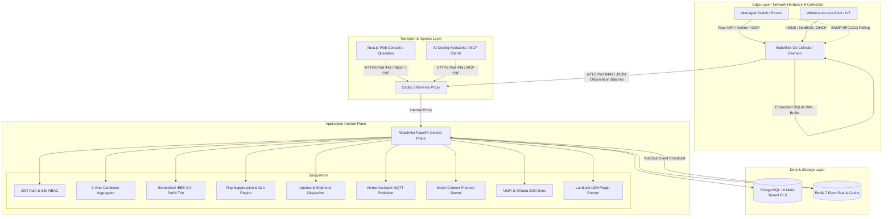

# WatchNet Clean Rebuild: Technical Architecture & System Design
## Modern, Modular, Production-Grade Architecture for Enterprise & Homelab Operations

**Document ID:** REBUILD-ARCH-001  
**Version:** 2.0.0-Rebuild  
**Status:** SPECIFIED & AUTHORITATIVE  
**Governing Standard:** Modular Clean Architecture, Zero Monolith Regression, Full Clean-Room Licensing Compliance  

---

## 1. Architectural Philosophy & Technology Justification

WatchNet v2.0 is engineered as a high-performance, modular system designed to span single-node homelab deployments up to globally distributed enterprise networks.

### Layered Technology Justification Table

| Architectural Layer | Selected Technology | Technical Justification | Rejection Rationale for Alternatives |
| :--- | :--- | :--- | :--- |
| **Backend API & Core** | **Python 3.12+ / FastAPI** | Asynchronous I/O, native Pydantic v2 validation, OpenAPI/Swagger auto-generation, rich ecosystem for integrations (`apprise`, `aiomqtt`). | Rejected Flask/Django: synchronous blocking, legacy WSGI, lack of native modern type validation. |
| **Edge Discovery Engine** | **Go 1.22+** | Compiled native binary, zero VM overhead, native raw AF_PACKET/AF_NETLINK sockets, low memory footprint (< 25 MB RAM). | Rejected Python for raw packet capture: GIL limitations, heavy memory overhead, slow packet loop. |
| **Web Console UI** | **Next.js 15 / React 18 / TS** | App router, compiled TypeScript type safety, virtualized high-density tables, SVG interactive canvas, Tailwind CSS. | Rejected PHP/jQuery: legacy security vulnerabilities (XSS, SQLi), poor state management, lack of type safety. |
| **Database Engine** | **PostgreSQL 16** | Multi-Version Concurrency Control (MVCC), kernel Row-Level Security (RLS), JSONB indexing, high concurrent write throughput. | Rejected SQLite for core DB: global write lock contention (`database is locked`), zero multi-tenant security. |
| **Cache & Event Bus** | **Redis 7** | In-memory pub/sub for Server-Sent Events (SSE), atomic rate-limiting counters, temporary lease coordination. | Rejected RabbitMQ/Kafka: unnecessary operational complexity for homelabs and small offices. |
| **Reverse Proxy** | **Caddy 2** | Automatic TLS, HTTP/2 and HTTP/3 support, single-line reverse proxy config, client certificate verification. | Rejected Nginx: complex manual certificate renewals and verbose configuration syntax. |

---

## 2. High-Level System Architecture Diagram

---

## 3. Detailed Subsystem Specifications

### 3.1 Edge Discovery Collector (Go)
- **Directory:** `services/collector/`
- **Native Raw Socket Capture:** Bypasses external Linux utilities (`arp-scan`, `fping`). Operates directly on `AF_PACKET` (Linux) and `BPF` (macOS/BSD).
- **Token-Bucket Discovery Pacing:** Enforces a strict 100 packets/second burst ceiling (`services/collector/internal/discovery/rate_limiter.go`).
- **Protocol Discovery Modules:**
  - `sweep.go`: Active ARP sweeping.
  - `ping.go`: Active ICMP ping sweeps with jittered scheduling.
  - `mdns.go`: Passive UDP 5353 multicast listener for Apple/IoT service records.
  - `netbios.go`: UDP 137 NetBIOS Name Query client for Windows systems.
  - `dhcp_probe.go`: Broadcast DHCP Discover broadcaster for rogue DHCP detection.
  - `snmp.go`: Typed SNMPv2c/v3 client querying switch ARP tables.
  - `wol.go`: UDP Wake-on-LAN magic packet broadcaster.
- **Tiered Durability Buffer:** Embedded SQLite WAL buffer (`services/collector/internal/buffer/buffer.go`). Observations are written locally with synchronous WAL commits, guaranteeing zero loss during WAN disconnects.

### 3.2 Control Plane Backend (FastAPI)
- **Directory:** `services/api/`
- **Multi-Tenant Row-Level Security:** Every query executes under session context `SET LOCAL app.current_tenant_id = '<uuid>'`. Unprivileged role `watchnet_app` is blocked from cross-tenant data access by PostgreSQL engine.
- **Embedded OUI Trie:** `services/api/app/core/oui_resolver.py` stores 45,000+ IEEE hardware prefixes in a memory-efficient prefix tree, resolving any MAC in $< 0.05 \text{ ms}$.
- **Four-Veto Gating Candidate Promotion:** Multi-signal observation scoring validating MAC, IP, Subnet, and OS before promoting candidates to permanent inventory.
- **Apprise Notification Gateway:** Integrated `apprise` library providing out-of-the-box alerting to Discord, Slack, Teams, Telegram, Signal, Gotify, Matrix, and 80+ platforms.
- **Home Assistant MQTT Gateway:** Real-time entity discovery publishing formatted to `homeassistant/binary_sensor/{tenant}_{mac}/config`.
- **Model Context Protocol (MCP) Server:** Exposes typed tools (`query_device`, `list_incidents`, `trigger_scan`, `remediate`) over SSE and JSON-RPC 2.0.

### 3.3 Modern Web Frontend (Next.js 15)
- **Directory:** `apps/web/`
- **Component System:** Tailwind CSS, Radix UI primitives, Lucide vector icons.
- **Key Views:**
  - `/devices`: Virtualized high-density table with custom column selector.
  - `/devices/[id]`: Device detail page with live diagnostic tools drawer (Ping, Port Scan, WOL, Traceroute).
  - `/topology`: Interactive SVG canvas mapping physical and gateway links with zero synthetic data.
  - `/presence`: 24x7 color-coded hourly presence heatmap matrix.
  - `/integrations`: One-click configuration for UniFi, Omada, Pi-hole, AdGuard, MQTT, and Apprise.

