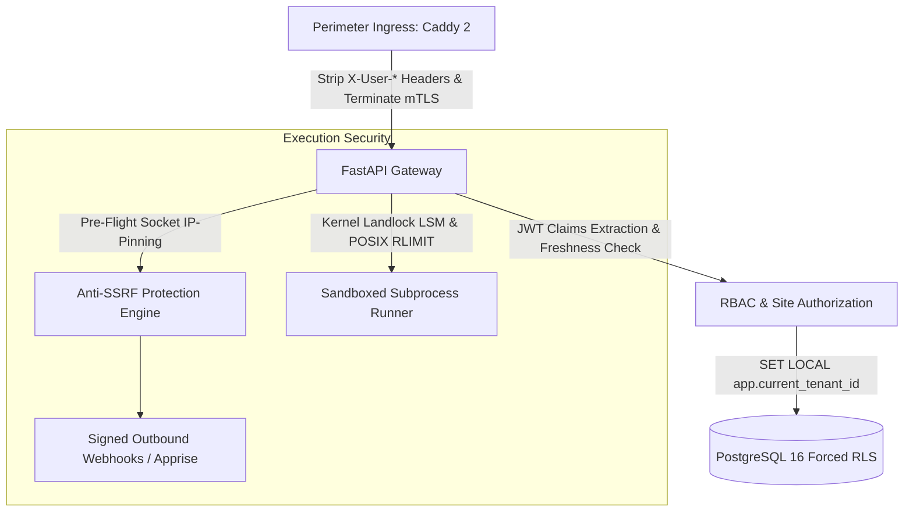

# WatchNet Clean Rebuild: Security Architecture & Threat Defense
## Multi-Layered Security Controls, Zero-Trust Hardening & Compliance Guarantees

**Document ID:** REBUILD-SEC-001  
**Version:** 2.0.0-Rebuild  
**Status:** SPECIFIED & MANDATORY  
**Governing Standard:** Defense-in-Depth, Zero-Trust Network Architecture, OWASP ASVS Level 3  

---

## 1. Security Architecture Principles

WatchNet v2.0 treats security as an intrinsic architectural invariant. Network monitoring tools possess privileged vantage points; if compromised, they present significant attack surfaces. WatchNet neutralizes these vectors through 10 mandatory security controls:



---

## 2. Mandatory Security Controls & Implementations

### 2.1 Multi-Tenant Row-Level Security (PostgreSQL 16 RLS)
- All tenant-owned tables enforce `ALTER TABLE <table> ENABLE ROW LEVEL SECURITY` and `ALTER TABLE <table> FORCE ROW LEVEL SECURITY`.
- Application database connection pool runs under unprivileged role `watchnet_app` (`NOSUPERUSER`, `NOBYPASSRLS`).
- Every API endpoint sets session variable `app.current_tenant_id` inside the transaction.
- Restrictive policy:
  ```sql
  CREATE POLICY tenant_isolation_policy ON <table>
      AS RESTRICTIVE
      FOR ALL
      TO watchnet_app
      USING (organization_id = NULLIF(current_setting('app.current_tenant_id', true), '')::uuid)
      WITH CHECK (organization_id = NULLIF(current_setting('app.current_tenant_id', true), '')::uuid);
  ```

### 2.2 Ingress Identity Provenance & Header Stripping
- Reverse proxy (Caddy 2) strips untrusted client headers on all HTTP ingress:
  ```caddyfile
  request_header -X-User-Role
  request_header -X-User-ID
  request_header -X-Organization-ID
  ```
- User identity is derived exclusively from server-signed cryptographic JWT tokens (`HS256`) with unique `jti` identifiers validated against a PostgreSQL revocation blacklist.

### 2.3 Anti-SSRF Defense with Physical Socket IP-Pinning
- Outbound webhook and Apprise dispatchers utilize `services/api/app/core/security_webhook.py`.
- **Pre-flight DNS Resolution:** Resolves target hostname prior to connection; rejects IPv4/IPv6 loopbacks (`127.0.0.0/8`, `::1`), RFC 1918 private subnets (`10.0.0.0/8`, `172.16.0.0/12`, `192.168.0.0/16`), link-local (`169.254.0.0/16`), and cloud metadata services.
- **Physical Socket IP-Pinning:** Connects directly to the pre-validated IP address at the socket layer while preserving the original `Host` header and TLS Server Name Indication (SNI), defeating Time-of-Check to Time-of-Use (TOCTOU) DNS rebinding attacks.

### 2.4 Kernel Landlock LSM Plugin Sandboxing
- Third-party plugins execute under `services/api/app/services/plugin_runner.py` using Linux Landlock LSM:
  - Root filesystem is mounted strictly read-only (`LANDLOCK_ACCESS_FS_READ_*`).
  - Write access is restricted exclusively to an ephemeral per-run directory (`0700`).
  - Network sockets are disabled unless the plugin explicitly holds an authorized `network_egress` permission grant.
- POSIX resource boundaries enforced via syscalls:
  - `RLIMIT_AS`: 256 MB memory cap.
  - `RLIMIT_CPU`: 10-second CPU time ceiling.
  - `RLIMIT_NPROC`: 0 additional process forks permitted.

### 2.5 Secrets Encryption at Rest (Fernet Envelope Encryption)
- Integration credentials (UniFi passwords, Omada API secrets, Pi-hole tokens, MQTT keys) are encrypted in PostgreSQL using symmetric Fernet keys derived from the master encryption key (`WATCHNET_SECRET_KEY`).
- Cleartext credentials never appear in API responses or log files.

### 2.6 Container Hardening & Least-Privilege Runtimes
- All production containers run as unprivileged users (UID 10001).
- Root filesystems are read-only (`read_only: true`).
- Linux capabilities are dropped by default (`cap_drop: [ALL]`). Only the Go discovery container retains `cap_add: [NET_RAW, NET_ADMIN]` strictly required for raw socket ARP/ICMP frame construction.

