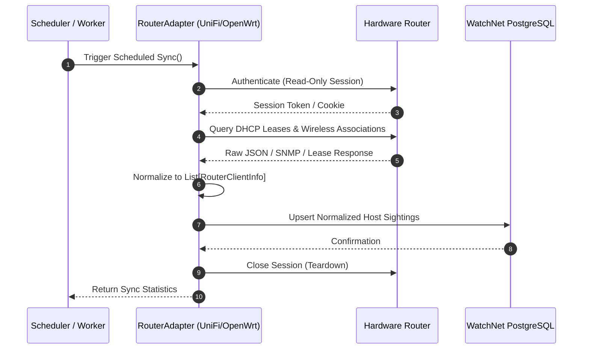

# WatchNet Router Integration Architecture

**Document Version:** 1.0.0  
**Core Invariant:** The Read-Only Router Invariant  
**Supported Platforms:** UniFi, OpenWrt, MikroTik, AsusWRT, FRITZ!Box, Freebox, OPNsense  

---

## 1. The Read-Only Router Invariant

A fundamental architectural mandate of WatchNet is the **Read-Only Router Invariant**:
- WatchNet never modifies router configuration, firewall rules, DHCP pools, or routing tables without explicit administrative multi-factor authorization.
- All router integrations operate using restricted read-only credentials (e.g. UniFi Read-Only Administrator, MikroTik `read` policy group).
- Credentials are cryptographically protected using AES-256-GCM.

---

## 2. Hardware-Agnostic Router Adapter Contract

```python
from abc import ABC, abstractmethod
from typing import List
from pydantic import BaseModel

class RouterClientInfo(BaseModel):
    mac_address: str
    ip_address: str
    hostname: str | None
    interface: str | None
    signal_strength_dbm: int | None
    rx_bytes: int | None
    tx_bytes: int | None

class BaseRouterAdapter(ABC):
    @abstractmethod
    async def connect(self) -> None:
        pass

    @abstractmethod
    async def get_dhcp_leases(self) -> List[RouterClientInfo]:
        """Fetch active DHCP leases from the router."""
        pass

    @abstractmethod
    async def get_wireless_clients(self) -> List[RouterClientInfo]:
        """Fetch associated wireless clients and signal telemetry."""
        pass

    @abstractmethod
    async def disconnect(self) -> None:
        pass
```

---

## 3. Sync Sequence Diagram


