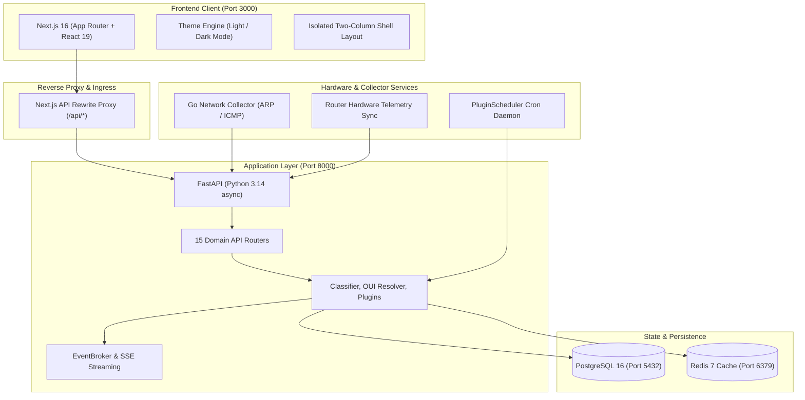

# WatchNet Architecture: Complete Master Index & System Blueprint

## 1. System Overview & Technology Stack
WatchNet is an enterprise-grade network security, asset inventory, and continuous telemetry monitoring platform built with feature parity to legacy upstream.

---

## 2. Feature Architecture Documents Index

Each major feature has its own comprehensive system design and architecture specification document:

| # | Architecture Document | Core Functionality | Mermaid Diagrams Included |
| :---: | :--- | :--- | :--- |
| **01** | [01_DEVICE_INVENTORY.md](./01_DEVICE_INVENTORY.md) | Multi-signal classification, OUI vendor parsing, field locking, MAC normalization | Data Flow, Pipeline, Entity DB, Sequence |
| **02** | [02_NETWORK_DISCOVERY.md](./02_NETWORK_DISCOVERY.md) | Concurrency ping sweeps, ARP table ingestion, targeted port probing, mDNS | State Machine, Fan-out Worker Pool |
| **03** | [03_ROUTER_GATEWAYS.md](./03_ROUTER_GATEWAYS.md) | OpenWrt, UniFi Controller, MikroTik, TP-Link `PASSIVE_DISCOVERY` mode | Class Diagram, Taxonomy, Sync Sequence |
| **04** | [04_MONITORING_AND_SPEEDTEST.md](./04_MONITORING_AND_SPEEDTEST.md) | Multi-resolver DNS latency, Cloudflare speedtest, website uptime, wallboard | Pipeline, Speedtest Sequence, DB Schema |
| **05** | [05_DNS_AND_FAMILY_SAFETY.md](./05_DNS_AND_FAMILY_SAFETY.md) | Kid profiles, device grouping, Internet pause, recurring bedtime curfews | Policy Flow, Bedtime Sequence, DB Schema |
| **06** | [06_NOTIFICATIONS_AND_WORKFLOWS.md](./06_NOTIFICATIONS_AND_WORKFLOWS.md) | Telegram, Discord, Slack, Pushover, event rules engine, webhook triggers | Event Architecture, Alert Sequence |
| **07** | [07_PLUGINS_AND_INTEGRATIONS.md](./07_PLUGINS_AND_INTEGRATIONS.md) | Modular plugin runtime, execution logs capture, dynamic JSON configuration | Lifecycle Pipeline, Execution Sequence |
| **08** | [08_MULTISITE_SYNC.md](./08_MULTISITE_SYNC.md) | Central hub-and-spoke aggregation, encrypted satellite enrollment, delta sync | Topology Architecture, Batch Sync Sequence |
| **09** | [09_SYSTEM_MAINTENANCE_AND_BACKUPS.md](./09_SYSTEM_MAINTENANCE_AND_BACKUPS.md) | One-click encrypted `.tar.gz` database backups, download pipeline, vacuuming | Backup/Restore Pipeline, Sequence Diagram |

---

## 3. Security, Performance & Scalability Principles

1. **Role-Based Access Control (RBAC)**:
   - 5 distinct user roles: `Owner`, `Administrator`, `Operator`, `Guardian`, and `Viewer`.
   - Sensitive administrative operations (database backups, user deletion, router password changes) are restricted to `Administrator` and `Owner`.
2. **Dual-Token Authentication**:
   - Access tokens (JWT, 24-hour expiration) with matching cryptographic signature (`HS256`).
   - Dual delivery support: both `Authorization: Bearer <token>` header (for cross-origin/proxied API requests) and HttpOnly Secure cookies.
3. **Partitioned Historical Tables**:
   - Presence history and scan telemetry are partitioned by month in PostgreSQL to maintain sub-10ms query times over multi-year deployments.
4. **Resilient Non-Blocking Architecture**:
   - Long-running speedtests, subnet sweeps, and database exports run asynchronously in background thread pools; frontend receives instant `202 Accepted` responses with zero UI blocking.
