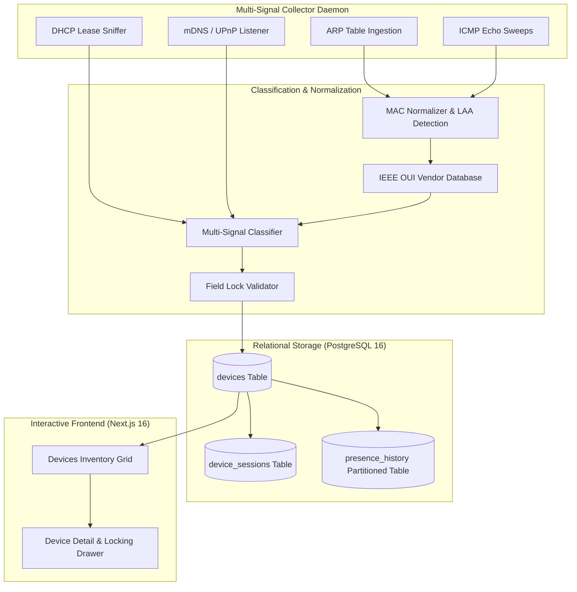
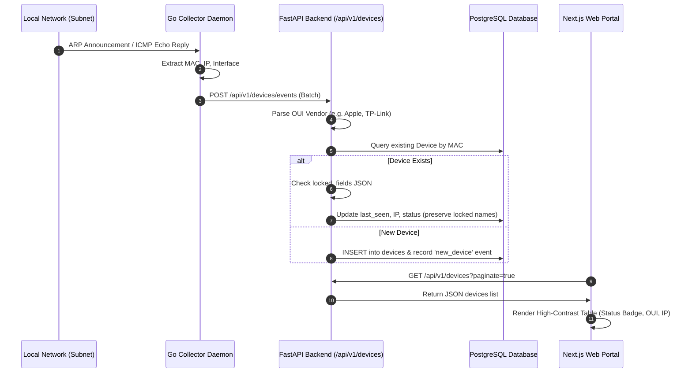

# WatchNet Architecture: Device Inventory & Multi-Signal Recognition

## 1. Executive Summary & Capabilities
The **Device Inventory Engine** provides real-time tracking, hardware classification, and historical presence tracking for every network participant. Rather than relying on a single data source, WatchNet correlates:
1. **Layer-2 Physical Frame Data**: MAC address, OUI vendor parsing, IEEE 802 Local Administered Address (LAA) randomization detection.
2. **Layer-3 Addressing**: IPv4/IPv6 address assignments, interface bindings, and subnet segmentation.
3. **Layer-7 Fingerprinting & Hostnames**: NetBIOS names, mDNS (`.local`), DHCP Option 12 / 55 (Parameter Request List), HTTP user-agent sniffing, and UPnP device descriptors.
4. **Field Locking**: Protects user-defined friendly names, custom icons, VLAN assignments, and device categories from automated scan overwrites.

---

## 2. System Architecture & Data Flow



---

## 3. Database Schema Design

### Core Device Entity (`devices` table)
```sql
CREATE TABLE devices (
    id UUID PRIMARY KEY DEFAULT gen_random_uuid(),
    mac VARCHAR(17) UNIQUE NOT NULL,
    ipv4 VARCHAR(45),
    ipv6 VARCHAR(45),
    vendor VARCHAR(255),
    name VARCHAR(255),
    interface VARCHAR(50),
    status VARCHAR(20) NOT NULL DEFAULT 'unknown',
    category VARCHAR(50) NOT NULL DEFAULT 'Unknown',
    icon VARCHAR(50),
    notes TEXT,
    is_archived BOOLEAN NOT NULL DEFAULT FALSE,
    locked_fields JSONB NOT NULL DEFAULT '[]'::jsonb,
    custom_properties JSONB NOT NULL DEFAULT '{}'::jsonb,
    first_seen TIMESTAMP WITH TIME ZONE NOT NULL,
    last_seen TIMESTAMP WITH TIME ZONE NOT NULL,
    site_id UUID REFERENCES remote_sites(id) ON DELETE SET NULL
);
CREATE INDEX ix_devices_mac ON devices(mac);
CREATE INDEX ix_devices_ipv4 ON devices(ipv4);
CREATE INDEX ix_devices_last_seen ON devices(last_seen);
```

---

## 4. Hardware Classification Logic
Devices are categorized automatically using a decision matrix:
- **`Mobile`**: Vendor Apple/Samsung/Xiaomi + mDNS mobile tags + DHCP hostname pattern matches (e.g. `iPhone`, `Galaxy`, `Pixel`).
- **`IoT/Smart Home`**: Espressif/Tuya/Shelly MAC OUI, MQTT/CoAP ports open, or SSDP smart bulb/plug descriptors.
- **`Network/Infrastructure`**: Gateway IP match, OpenWrt/UniFi signatures, 802.11 AP beacons, or managed switches.
- **`Desktop/Laptop`**: Intel/Realtek NICs, workstation DHCP option 55 signatures, or Windows/macOS NetBIOS services.
- **`Server`**: Static IP leases, virtualization MAC ranges (VMware `00:50:56`, Proxmox, Docker), and standard server ports (SSH, HTTP, DNS).

---

## 5. Sequence Diagram: Device Discovery to UI Display


