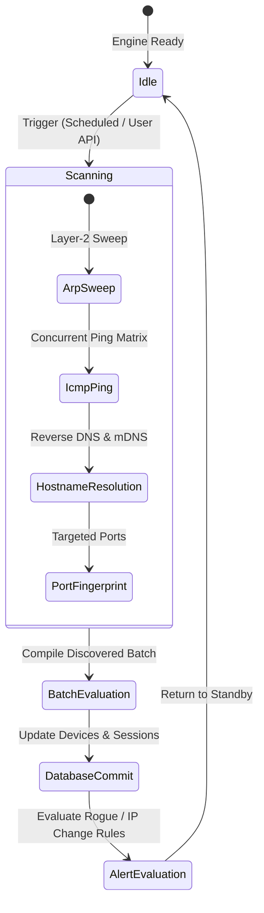
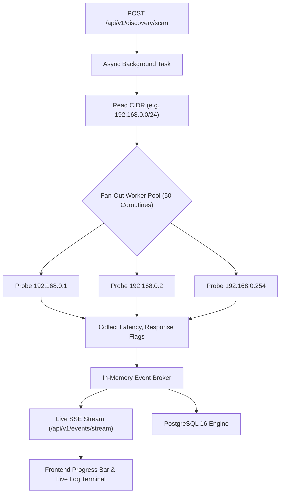

# WatchNet Architecture: Network Discovery Engine

## 1. Executive Summary & Capabilities
The **Network Discovery Engine** orchestrates non-disruptive, multi-protocol scans across IPv4 and IPv6 subnets. It detects active hosts, identifies rogue devices, resolves hostnames, and reconstructs network topology without requiring agent software installed on endpoints.

### Core Discovery Modules:
1. **Layer-2 ARP Table & Passive Sniffing**: Continuous monitoring of `/proc/net/arp` and Windows `GetIpNetTable` cache.
2. **Layer-3 ICMP Concurrency Ping Sweeps**: High-speed asynchronous echo requests across CIDR ranges (e.g. `/24`, `/16`).
3. **Layer-4 Lightweight Port Probing**: Targeted scans against ports `22` (SSH), `53` (DNS), `80/443` (HTTP/HTTPS), `445` (SMB), and `8080/8443` (Web Admin) for OS fingerprinting.
4. **Layer-7 Reverse DNS (PTR) & mDNS Resolvers**: Queries local PTR records and multicast DNS `224.0.0.251:5353` for zero-configuration hostnames.

---

## 2. System Architecture & Scanning State Machine

---

## 3. Subnet Scanning & CIDR Range Processing Flow

---

## 4. API Specification & Endpoints

| Endpoint | Method | Role | Description |
| :--- | :--- | :--- | :--- |
| `/api/v1/discovery/scan` | `POST` | Trigger | Initiates an immediate asynchronous scan of configured subnets. |
| `/api/v1/discovery/status` | `GET` | Telemetry | Returns current engine state (`idle` or `scanning`), progress %, and scan duration. |
| `/api/v1/discovery/logs` | `GET` | Audit | Retrieves chronological scan audit entries and discovered IP/MAC associations. |
| `/api/v1/discovery/toggle-module` | `POST` | Configuration | Enables or disables individual discovery modules (e.g. toggle mDNS, toggle ICMP). |

---

## 5. Security & Network Load Mitigation
- **Rate-Limited Packets**: Burst rate capped at 200 packets/sec to prevent saturating consumer WiFi routers (e.g. TP-Link TL-WR841N).
- **Dynamic Jitter**: Randomized inter-packet delays prevent network switch MAC flooding table overflow.
- **Fail-Safe Timeout**: Per-host response timeout capped at 250ms with 1 retry max.
