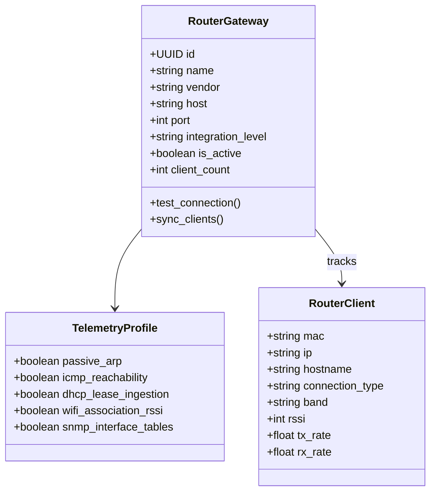
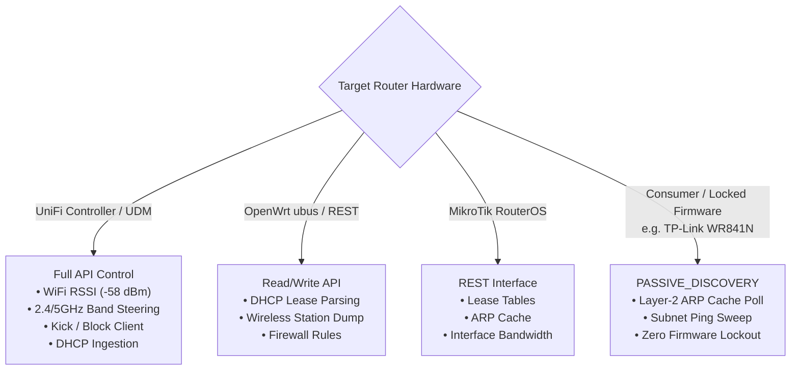
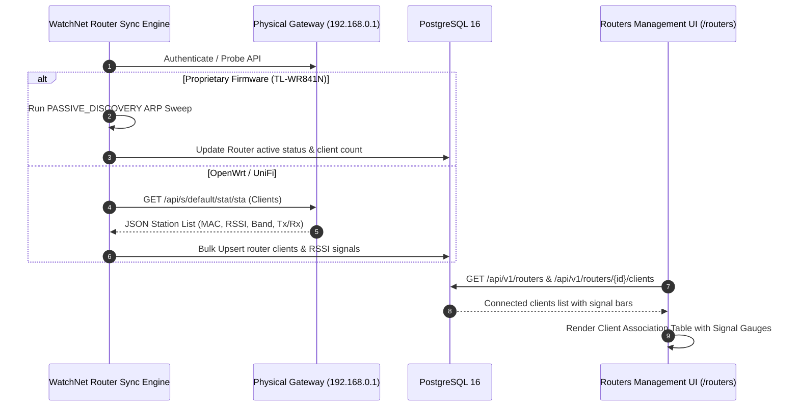

# WatchNet Architecture: Gateway Routers & Hardware Telemetry

## 1. Executive Summary & Capabilities
The **Routers & Gateway Telemetry Subsystem** bridges the gap between passive endpoint packet sniffing and authoritative hardware routing state. It interfaces with commercial, enterprise, and open-source network gateways:
1. **OpenWrt / LuCI Gateways**: REST API, `ubus` RPC, and SSH command execution.
2. **UniFi Dream Machine (UDM/USG)**: UniFi OS API authentication (`/api/auth/login`), real-time wireless client associations, RSSI dBm, and TX/RX link rates.
3. **MikroTik RouterOS**: RouterOS REST API (`/rest/ip/dhcp-server/lease`) and interface stats.
4. **Proprietary Consumer Gateways (e.g. TP-Link TL-WR841N)**: Supported under **`PASSIVE_DISCOVERY`** mode—monitoring Layer-2 ARP ingestion and continuous ICMP reachability without triggering firmware lockouts.

---

## 2. Integration Levels & Gateway State Machine



---

## 3. Integration Level Taxonomy



---

## 4. Sequence: Router Client Sync & RSSI Ingestion



---

## 5. Database Schema (`routers` table)
```sql
CREATE TABLE routers (
    id UUID PRIMARY KEY DEFAULT gen_random_uuid(),
    name VARCHAR(100) NOT NULL,
    vendor VARCHAR(50) NOT NULL,
    model VARCHAR(100),
    firmware VARCHAR(100),
    host VARCHAR(255) NOT NULL,
    port INTEGER NOT NULL DEFAULT 80,
    username VARCHAR(100),
    password_encrypted TEXT,
    integration_level VARCHAR(50) NOT NULL DEFAULT 'read_only_api',
    is_active BOOLEAN NOT NULL DEFAULT TRUE,
    last_connected_at TIMESTAMP WITH TIME ZONE,
    created_at TIMESTAMP WITH TIME ZONE NOT NULL,
    updated_at TIMESTAMP WITH TIME ZONE NOT NULL
);
```
