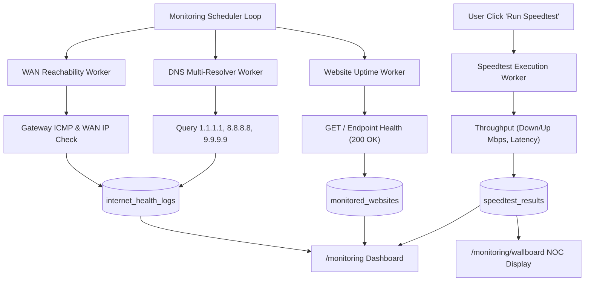
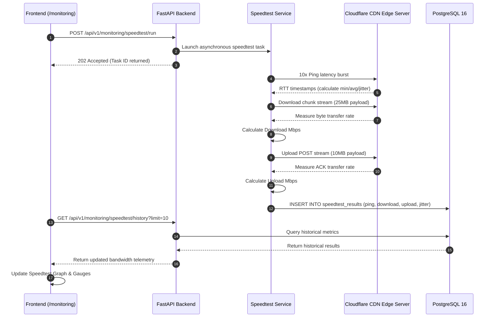

# WatchNet Architecture: Internet Health, Speedtest & Monitoring

## 1. Executive Summary & Capabilities
The **Monitoring Subsystem** tracks continuous WAN reachability, DNS query latencies, bandwidth throughput, and external website uptime. It includes:
1. **Multi-Resolver DNS Latency Benchmarking**: Probes Cloudflare (`1.1.1.1`), Google (`8.8.8.8`), and Quad9 (`9.9.9.9`) every 60 seconds.
2. **On-Demand & Scheduled Speedtests**: Utilizes Cloudflare Speedtest CDN edges to measure jitter, ping latency, download Mbps, and upload Mbps without relying on external third-party binary bloat.
3. **HTTP/HTTPS Website Availability**: Monitors target internal/external endpoints with TLS certificate validation, response time tracking, and HTTP status code verification.
4. **NOC Wallboard Display**: High-contrast, full-screen dashboard designed for continuous monitoring operations.

---

## 2. System Architecture & Measurement Pipeline



---

## 3. Speedtest State & Measurement Sequence



---

## 4. Database Schema Design

### `speedtest_results`
```sql
CREATE TABLE speedtest_results (
    id UUID PRIMARY KEY DEFAULT gen_random_uuid(),
    ping_ms FLOAT NOT NULL,
    jitter_ms FLOAT NOT NULL,
    download_mbps FLOAT NOT NULL,
    upload_mbps FLOAT NOT NULL,
    server_name VARCHAR(100),
    server_location VARCHAR(100),
    created_at TIMESTAMP WITH TIME ZONE NOT NULL DEFAULT NOW()
);
CREATE INDEX ix_speedtest_created_at ON speedtest_results(created_at);
```

### `internet_health_logs`
```sql
CREATE TABLE internet_health_logs (
    id UUID PRIMARY KEY DEFAULT gen_random_uuid(),
    is_connected BOOLEAN NOT NULL,
    wan_ip VARCHAR(45),
    gateway_latency_ms FLOAT,
    dns_resolution_ms FLOAT,
    dns_resolvers JSONB DEFAULT '{}'::jsonb,
    created_at TIMESTAMP WITH TIME ZONE NOT NULL DEFAULT NOW()
);
```
