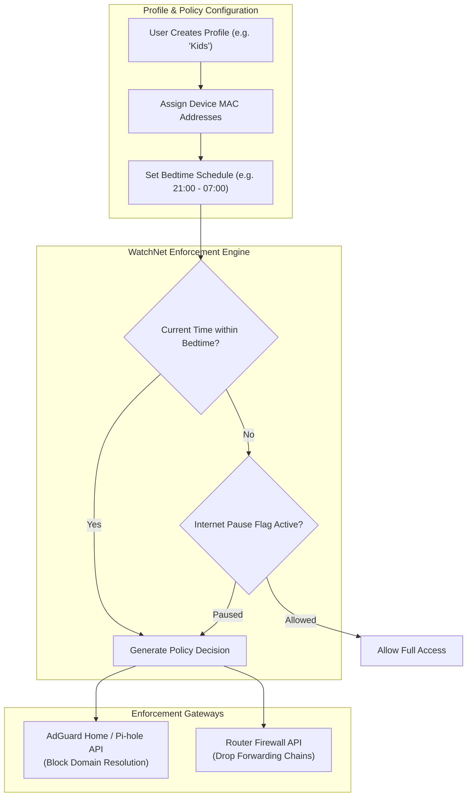
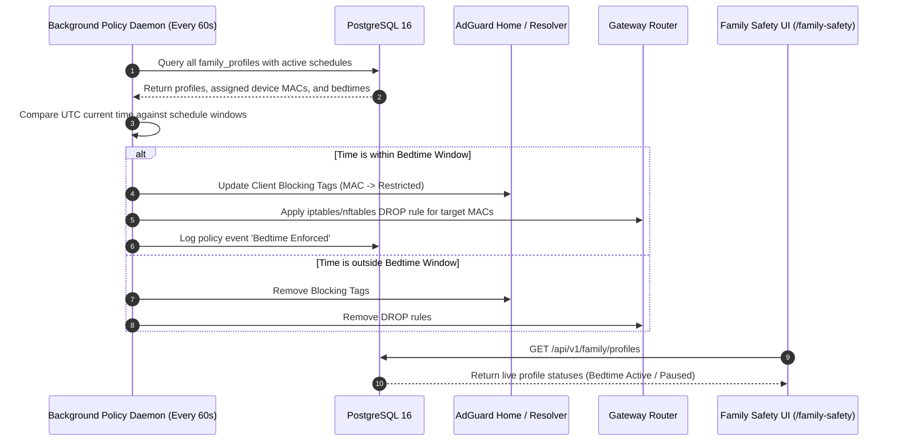

# WatchNet Architecture: DNS Intelligence & Family Safety

## 1. Executive Summary & Capabilities
The **DNS Intelligence & Family Safety Subsystem** protects connected family devices and young users through policy enforcement, domain filtering, and time-based access control:
1. **Kid Profiles & Device Grouping**: Assign one or more device MAC addresses to a family member profile (e.g. *"Kids Tablet"*, *"Study Laptop"*).
2. **One-Click Internet Pause**: Temporarily halts Internet routing or DNS resolution for specific family member devices with zero impact on adult workstations or IoT systems.
3. **Bedtime & Screen-Time Schedules**: Recurring schedules that automatically enforce internet curfews (e.g. Mon-Fri 21:00 to 07:00).
4. **AdGuard Home / Pi-hole Sync**: Pulls upstream DNS block logs, query analytics, and category filter decisions into WatchNet.

---

## 2. System Architecture & Policy Enforcement Flow



---

## 3. Database Schema Design

### `family_profiles`
```sql
CREATE TABLE family_profiles (
    id UUID PRIMARY KEY DEFAULT gen_random_uuid(),
    name VARCHAR(100) NOT NULL,
    avatar VARCHAR(50),
    is_paused BOOLEAN NOT NULL DEFAULT FALSE,
    content_filter_level VARCHAR(50) NOT NULL DEFAULT 'standard',
    bedtime_start VARCHAR(5), -- '21:00'
    bedtime_end VARCHAR(5),   -- '07:00'
    bedtime_days JSONB DEFAULT '["Mon","Tue","Wed","Thu","Sun"]'::jsonb,
    created_at TIMESTAMP WITH TIME ZONE NOT NULL,
    updated_at TIMESTAMP WITH TIME ZONE NOT NULL
);
```

### `profile_devices` (Join Table)
```sql
CREATE TABLE profile_devices (
    profile_id UUID NOT NULL REFERENCES family_profiles(id) ON DELETE CASCADE,
    device_id UUID NOT NULL REFERENCES devices(id) ON DELETE CASCADE,
    PRIMARY KEY (profile_id, device_id)
);
```

---

## 4. Sequence: Schedule Check & Automatic Bedtime Enforcement


