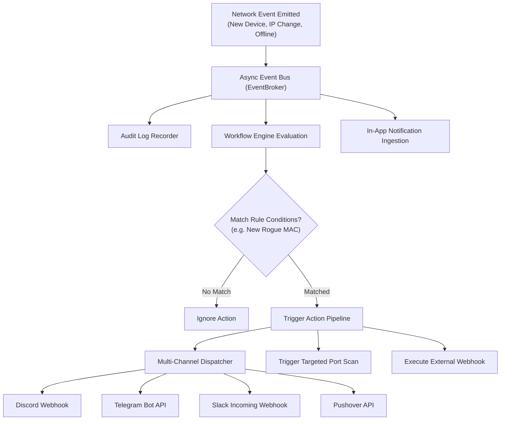
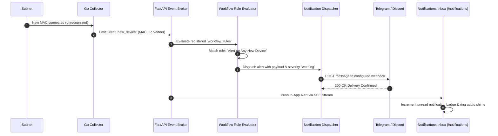

# WatchNet Architecture: Notifications, Workflows & Automations

## 1. Executive Summary & Capabilities
The **Workflows & Notifications Subsystem** gives administrators real-time awareness and event-driven automation:
1. **Multi-Channel Dispatcher**: Transmits alerts to Discord, Telegram, Slack, Pushover, Email (SMTP), and generic Webhooks.
2. **Event Rule Engine**: Evaluates incoming network events against user-defined predicates (e.g. `event_type == 'new_device'`, `severity == 'critical'`, `ip_changed == true`).
3. **Automated Actions**: Executes webhooks, triggers subnet sweeps, restarts plugins, or logs audit entries when rules fire.
4. **In-App Notification Center**: Real-time notification bell dropdown with read/unread tracking and severity filters.

---

## 2. Event-Driven Workflow Architecture



---

## 3. Database Schema Design

### `notification_channels`
```sql
CREATE TABLE notification_channels (
    id UUID PRIMARY KEY DEFAULT gen_random_uuid(),
    name VARCHAR(100) NOT NULL,
    channel_type VARCHAR(50) NOT NULL, -- 'discord', 'telegram', 'slack', 'webhook'
    config JSONB NOT NULL DEFAULT '{}'::jsonb, -- encrypted webhook URLs, tokens
    is_enabled BOOLEAN NOT NULL DEFAULT TRUE,
    created_at TIMESTAMP WITH TIME ZONE NOT NULL DEFAULT NOW()
);
```

### `workflow_rules`
```sql
CREATE TABLE workflow_rules (
    id UUID PRIMARY KEY DEFAULT gen_random_uuid(),
    name VARCHAR(100) NOT NULL,
    trigger_event VARCHAR(50) NOT NULL, -- 'new_device', 'device_offline', 'ip_changed'
    conditions JSONB NOT NULL DEFAULT '{}'::jsonb, -- e.g. {"vendor": "Unknown"}
    actions JSONB NOT NULL DEFAULT '[]'::jsonb,    -- e.g. [{"action": "send_alert", "channel_id": "..."}]
    is_active BOOLEAN NOT NULL DEFAULT TRUE,
    execution_count INTEGER NOT NULL DEFAULT 0,
    last_triggered_at TIMESTAMP WITH TIME ZONE,
    created_at TIMESTAMP WITH TIME ZONE NOT NULL DEFAULT NOW()
);
```

---

## 4. Sequence: New Device Connection to Telegram/Discord Alert


