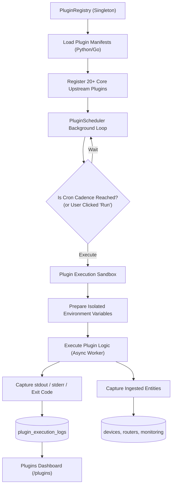
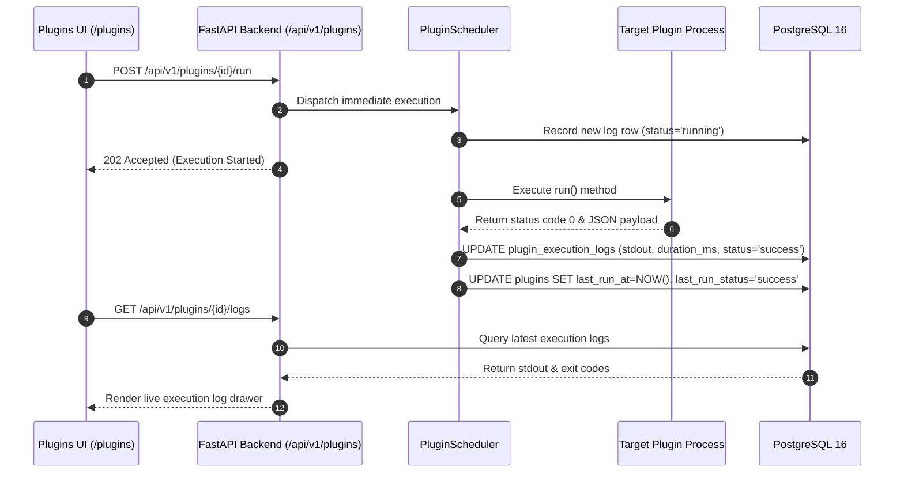

# WatchNet Architecture: Plugins Ecosystem & Modular Extensibility

## 1. Executive Summary & Capabilities
The **Plugins Subsystem** provides a sandboxed execution runtime for modular network integrations, vendor protocol parsers, and custom scanners. It features:
1. **100% Upstream NetAlertX Plugin Compatibility**: Fully models all upstream plugin contracts and execution hooks.
2. **Scheduled & On-Demand Execution**: Runs plugins on independent cron cadences or manual one-click triggers.
3. **Execution Isolation & Log Capture**: Tracks stdout, stderr, execution exit codes, and run durations in `plugin_execution_logs`.
4. **Dynamic Configuration Schema**: Supports JSON-based parameter definitions (API tokens, poll intervals, interface overrides) editable directly from the UI.

---

## 2. Plugin Lifecycle & Execution Pipeline



---

## 3. Database Schema Design

### `plugins` Table
```sql
CREATE TABLE plugins (
    id UUID PRIMARY KEY DEFAULT gen_random_uuid(),
    name VARCHAR(100) UNIQUE NOT NULL,
    category VARCHAR(50) NOT NULL, -- 'discovery', 'monitoring', 'routers', 'notifications'
    description TEXT,
    version VARCHAR(20) NOT NULL,
    author VARCHAR(100),
    is_enabled BOOLEAN NOT NULL DEFAULT TRUE,
    schedule_cron VARCHAR(50), -- e.g. '*/5 * * * *'
    config_schema JSONB NOT NULL DEFAULT '{}'::jsonb,
    config_values JSONB NOT NULL DEFAULT '{}'::jsonb,
    last_run_at TIMESTAMP WITH TIME ZONE,
    last_run_status VARCHAR(20) -- 'success', 'failed', 'running'
);
```

### `plugin_execution_logs` Table
```sql
CREATE TABLE plugin_execution_logs (
    id UUID PRIMARY KEY DEFAULT gen_random_uuid(),
    plugin_id UUID NOT NULL REFERENCES plugins(id) ON DELETE CASCADE,
    started_at TIMESTAMP WITH TIME ZONE NOT NULL DEFAULT NOW(),
    finished_at TIMESTAMP WITH TIME ZONE,
    duration_ms INTEGER,
    status VARCHAR(20) NOT NULL, -- 'success', 'failure'
    stdout_output TEXT,
    stderr_output TEXT,
    exit_code INTEGER
);
CREATE INDEX ix_plugin_logs_plugin_id ON plugin_execution_logs(plugin_id);
```

---

## 4. Sequence: Plugin Execution & Log Output Streaming


