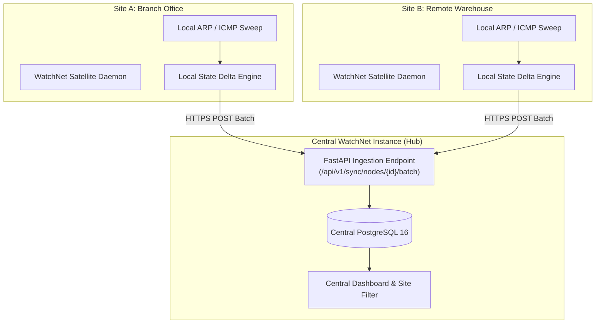
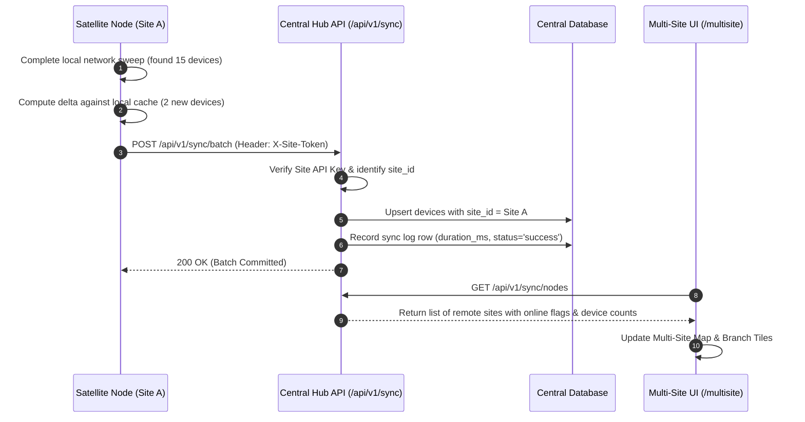

# WatchNet Architecture: Multi-Site Hub & Centralized Telemetry

## 1. Executive Summary & Capabilities
The **Multi-Site Hub Subsystem** enables distributed deployment topologies, allowing a single Central Hub instance to aggregate telemetry, devices, and alerts across branch offices, remote warehouses, home labs, and edge nodes:
1. **Hub-and-Spoke Topology**: Central WatchNet instance acts as the aggregator; remote satellite nodes run lightweight discovery daemons.
2. **Encrypted Node Enrollment**: Remote nodes authenticate using secure API keys and TLS certificates.
3. **Delta Synchronization**: Satellite nodes compute local diffs (new MACs, IP changes, offline transitions) and transmit compressed batches, minimizing WAN bandwidth.
4. **Site-Filtered Inventory**: The Web UI allows instant switching between "All Sites" or specific branch office inventories.

---

## 2. Multi-Site Synchronization Architecture



---

## 3. Database Schema Design

### `remote_sites` Table
```sql
CREATE TABLE remote_sites (
    id UUID PRIMARY KEY DEFAULT gen_random_uuid(),
    name VARCHAR(100) UNIQUE NOT NULL,
    description TEXT,
    api_key_hash VARCHAR(255) NOT NULL,
    ip_address VARCHAR(45),
    status VARCHAR(20) NOT NULL DEFAULT 'offline', -- 'online', 'offline', 'syncing'
    last_sync_at TIMESTAMP WITH TIME ZONE,
    device_count INTEGER NOT NULL DEFAULT 0,
    created_at TIMESTAMP WITH TIME ZONE NOT NULL DEFAULT NOW()
);
```

### `site_sync_logs` Table
```sql
CREATE TABLE site_sync_logs (
    id UUID PRIMARY KEY DEFAULT gen_random_uuid(),
    site_id UUID NOT NULL REFERENCES remote_sites(id) ON DELETE CASCADE,
    synced_at TIMESTAMP WITH TIME ZONE NOT NULL DEFAULT NOW(),
    duration_ms INTEGER NOT NULL,
    devices_synced INTEGER NOT NULL,
    events_created INTEGER NOT NULL,
    status VARCHAR(20) NOT NULL -- 'success', 'failed'
);
```

---

## 4. Sequence: Remote Satellite Batch Sync


