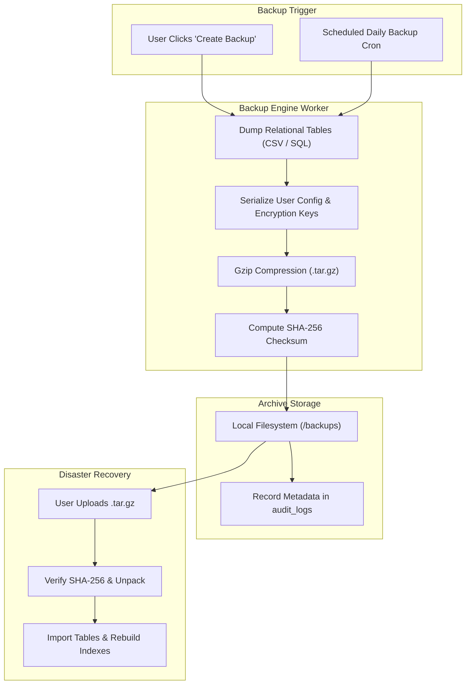
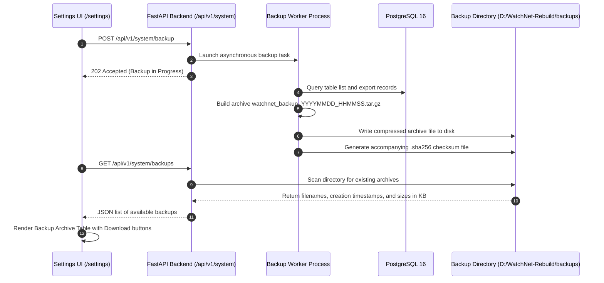

# WatchNet Architecture: System Maintenance, Backups & Disaster Recovery

## 1. Executive Summary & Capabilities
The **System Maintenance Subsystem** guarantees long-term database stability, high query performance, and disaster recovery:
1. **One-Click Encrypted Database Backups**: Compresses database tables, schema revisions, and user configuration into timestamped `.tar.gz` archives.
2. **Download & Restore Pipeline**: Allows downloading backup archives directly through the browser or uploading existing snapshots to restore a system.
3. **Automated Partition Rotation & Vacuuming**: Runs asynchronous SQLite `VACUUM` or PostgreSQL table re-indexing to prevent storage fragmentation.
4. **Data Retention Policies**: Configurable retention periods (e.g. 30, 90, 180, 365 days) that prune stale presence history and old scan logs automatically.

---

## 2. Backup & Restore Architecture

---

## 3. Sequence: One-Click Backup Generation

---

## 4. API Endpoints Specification

| Endpoint | Method | Role | Description |
| :--- | :--- | :--- | :--- |
| `/api/v1/system/backup` | `POST` | Create | Triggers asynchronous creation of a new `.tar.gz` database archive. |
| `/api/v1/system/backups` | `GET` | Inventory | Returns metadata for all backup archives present on disk. |
| `/api/v1/system/backup/download/{filename}` | `GET` | Download | Streams the compressed `.tar.gz` file directly to the browser. |
| `/api/v1/system/vacuum` | `POST` | Maintenance | Rebuilds database indexes and runs `VACUUM ANALYZE` on PostgreSQL. |
| `/api/v1/system/maintenance/stats` | `GET` | Health | Reports active database connection counts, database size on disk, and table row statistics. |
