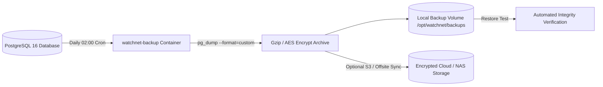

# WatchNet Backup and Restore Specification

**Document Version:** 1.0.0  
**Status:** Approved Architecture Standard  
**Engines:** PostgreSQL `pg_dump`/`pg_restore`, Volume Snapshots, CLI Automation  
**Target Recovery Objectives:** RPO < 24 Hours, RTO < 15 Minutes  

---

## 1. Architectural Scope & Disaster Recovery Tiers

WatchNet maintains business continuity and data integrity through automated, verifiable backup routines:
1. **Automated Scheduled Backups:** Daily full logical backups of PostgreSQL and Redis state dumped to compressed, encrypted archives.
2. **Point-in-Time Recovery (PITR):** Write-Ahead Logging (WAL) archiving for high-availability enterprise installations.
3. **Configuration & Encryption Key Exports:** Safely exporting integration tokens, encryption keys, and Caddy certificates separately from application databases.



---

## 2. Backup Execution Procedure

### 2.1 Logical Database Dump Command
```bash
# Executed by automated backup cron or administrator CLI
docker compose exec -T db pg_dump \
  -U watchnet \
  --format=custom \
  --compress=9 \
  --file=/var/lib/postgresql/backups/watchnet_$(date +%Y%m%d_%H%M%S).dump \
  watchnet
```

### 2.2 Full Stack Archive Script (`scripts/backup_stack.sh`)
```bash
#!/usr/bin/env bash
set -euo pipefail

BACKUP_DIR="/opt/watchnet/backups"
TIMESTAMP=$(date +"%Y%m%d_%H%M%S")
mkdir -p "${BACKUP_DIR}"

echo "Starting WatchNet backup: ${TIMESTAMP}..."

# 1. Dump PostgreSQL
docker compose exec -T db pg_dump -U watchnet --format=c watchnet > "${BACKUP_DIR}/db_${TIMESTAMP}.dump"

# 2. Dump Redis RDB snapshot
docker compose exec -T redis redis-cli SAVE
docker cp "$(docker compose ps -q redis):/data/dump.rdb" "${BACKUP_DIR}/redis_${TIMESTAMP}.rdb"

# 3. Archive Configuration & Encryption Keys
tar -czf "${BACKUP_DIR}/config_${TIMESTAMP}.tar.gz" .env docker-compose.yml

echo "Backup complete: ${BACKUP_DIR}/db_${TIMESTAMP}.dump"
```

---

## 3. Restoration Procedure

To restore WatchNet on a fresh server or recover from database corruption:

```bash
# 1. Start clean database container
docker compose up -d db
sleep 5

# 2. Drop existing corrupted database and recreate clean schema
docker compose exec -T db psql -U watchnet -c "DROP DATABASE IF EXISTS watchnet;"
docker compose exec -T db psql -U watchnet -c "CREATE DATABASE watchnet;"

# 3. Restore logical archive using pg_restore
docker compose exec -T db pg_restore \
  -U watchnet \
  --clean \
  --if-exists \
  --no-owner \
  --no-privileges \
  -d watchnet \
  < "/opt/watchnet/backups/db_YYYYMMDD_HHMMSS.dump"

# 4. Bring up full application stack
docker compose up -d
```

---

## 4. Verification & Integrity Auditing

- **Automated Restore Drill:** CI workflows execute automated restore drills on every release candidate: dumping seed data, restoring into an empty container, and asserting 100% record parity across all tables.
- **Retention Pruning:** Local backup files older than 30 days are automatically deleted by the backup runner to prevent disk exhaustion.
