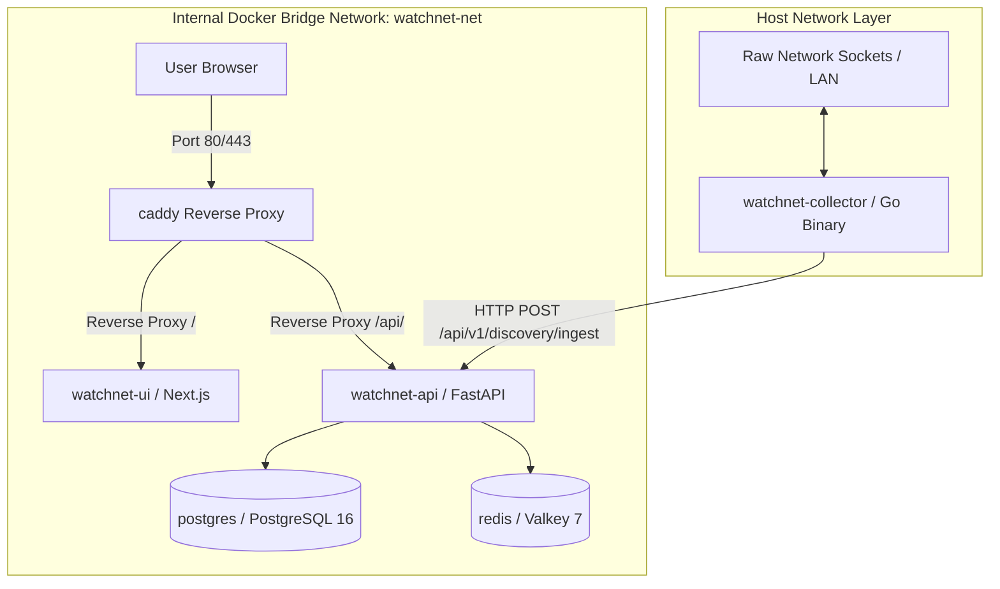

# WatchNet Docker Setup Specification

**Document Version:** 1.0.0  
**Status:** Approved Architecture Standard  
**Container Engines:** Docker Engine 24.0+, Podman 4.5+, Docker Compose v2.20+  
**Target Architectures:** `linux/amd64`, `linux/arm64` (Raspberry Pi 4/5, Apple Silicon)  

---

## 1. Container Images & Microservice Topology

WatchNet is structured as a set of decoupled, containerized services adhering to 12-factor application principles:

| Service Name | Base Image | Published Ports | Linux Capabilities | Filesystem Access |
|---|---|---|---|---|
| `watchnet-api` | `python:3.12-slim` | `8000:8000` | Default unprivileged | Read-only with `/tmp` tmpfs |
| `watchnet-ui` | `node:20-alpine` | `3000:3000` | Default unprivileged | Read-only |
| `watchnet-collector` | `alpine:3.19` (Go Binary) | Host Network | `CAP_NET_RAW`, `CAP_NET_BIND_SERVICE` | Read-only |
| `postgres` | `postgres:16-alpine` | `5432` (Internal) | Default | Named Volume `/var/lib/postgresql/data` |
| `redis` | `redis:7-alpine` | `6379` (Internal) | Default | Named Volume `/data` |
| `caddy` | `caddy:2-alpine` | `80:80`, `443:443` | Default | Named Volume `caddy_data` |



---

## 2. Host Networking & Discovery Requirements

Because passive ARP monitoring, DHCP lease sniffing, and mDNS multicast detection require access to the physical layer 2 broadcast domain, the `watchnet-collector` container must be deployed using **`network_mode: host`** on Linux hosts.
- **Mac / Windows Workstations (Docker Desktop):** Docker Desktop runs inside a lightweight virtual machine, isolating container bridge networks from physical Wi-Fi/Ethernet adapters. For local workstation development, the collector includes an HTTP simulation mode (`COLLECTOR_MOCK_DISCOVERY=true`) to generate synthetic LAN traffic without requiring host raw socket bridging.
- **Production Linux / Pi OS / TrueNAS / Unraid:** Uses native host networking with `CAP_NET_RAW` capability granted exclusively to the collector container.

---

## 3. Container Hardening & Security Profile

Every WatchNet container is built with production security hardening enabled:
- **Non-Root Execution:** All services execute under dedicated non-root service accounts (`uid: 10001:10001`).
- **Dropped Capabilities:** `cap_drop: [ALL]` applied across all services except the collector.
- **No New Privileges:** `security_opt: ["no-new-privileges:true"]` prevents privilege escalation vulnerabilities.
- **Healthchecks:** Periodic HTTP/TCP health checks ensure Docker orchestrators detect frozen processes and restart them automatically.

---

## 4. Multi-Architecture Build Pipeline

Containers are built using Docker Buildx and published to GitHub Container Registry:
```bash
docker buildx build \
  --platform linux/amd64,linux/arm64 \
  --tag ghcr.io/watchnet/watchnet-api:latest \
  --tag ghcr.io/watchnet/watchnet-api:1.0.0 \
  --push ./services/api
```
