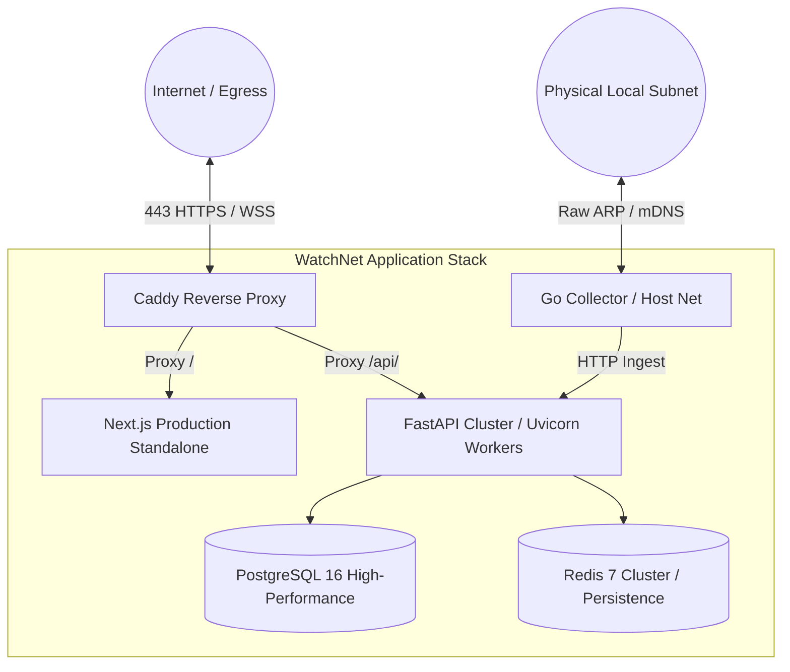

# WatchNet Production Deployment Specification

**Document Version:** 1.0.0  
**Status:** Approved Architecture Standard  
**Target Environments:** Dedicated Bare-Metal Linux, Proxmox VE VM, Raspberry Pi 5, Cloud VPS  
**Security Baseline:** CIS Linux Benchmark, Non-Root Containers, Automatic TLS  

---

## 1. Production Architecture Overview

A production WatchNet deployment isolates untrusted ingress, encrypts secrets, and guarantees high availability across power cycles and service restarts.



---

## 2. Host System Preparation (Ubuntu / Debian Server)

```bash
# 1. Update OS packages and install core security tools
sudo apt update && sudo apt upgrade -y
sudo apt install -y ufw curl fail2ban git jq

# 2. Configure Firewall (UFW)
sudo ufw default deny incoming
sudo ufw default allow outgoing
sudo ufw allow 22/tcp comment 'SSH Management'
sudo ufw allow 80/tcp comment 'HTTP ACME challenge'
sudo ufw allow 443/tcp comment 'HTTPS WatchNet Web UI'
sudo ufw enable

# 3. Optimize Linux Kernel Parameters for Network Probing (/etc/sysctl.d/99-watchnet.conf)
sudo tee /etc/sysctl.d/99-watchnet.conf <<EOF
# Increase ARP cache thresholds for large enterprise subnets
net.ipv4.neigh.default.gc_thresh1 = 1024
net.ipv4.neigh.default.gc_thresh2 = 2048
net.ipv4.neigh.default.gc_thresh3 = 4096

# Increase ephemeral socket ports and file descriptors
fs.file-max = 2097152
net.ipv4.ip_local_port_range = 1024 65535
EOF
sudo sysctl --system
```

---

## 3. Production Deployment Steps via Docker Compose

1. **Create Service User & Directory Structure:**
   ```bash
   sudo useradd -r -s /bin/false -d /opt/watchnet watchnet
   sudo mkdir -p /opt/watchnet/data/{postgres,redis,caddy}
   sudo chown -R watchnet:watchnet /opt/watchnet
   cd /opt/watchnet
   ```
2. **Download Verified Docker Compose and Production Env:**
   ```bash
   curl -sSL https://raw.githubusercontent.com/watchnet/watchnet/main/infrastructure/docker-compose.prod.yml -o docker-compose.yml
   # Configure production secrets in .env
   chmod 600 .env
   ```
3. **Database Migration & Startup:**
   ```bash
   # Pull latest verified images
   docker compose pull
   # Run database schema migrations
   docker compose run --rm api alembic upgrade head
   # Start full stack as systemd background service
   docker compose up -d
   ```

---

## 4. Systemd Service Integration

To ensure automatic startup on system boot, create `/etc/systemd/system/watchnet.service`:
```ini
[Unit]
Description=WatchNet Production Stack
Requires=docker.service
After=docker.service network.target

[Service]
Type=oneshot
RemainAfterExit=yes
WorkingDirectory=/opt/watchnet
ExecStart=/usr/bin/docker compose up -d
ExecStop=/usr/bin/docker compose down
TimeoutStartSec=0

[Install]
WantedBy=multi-user.target
```
Enable and start the service:
```bash
sudo systemctl daemon-reload
sudo systemctl enable --now watchnet.service
```
