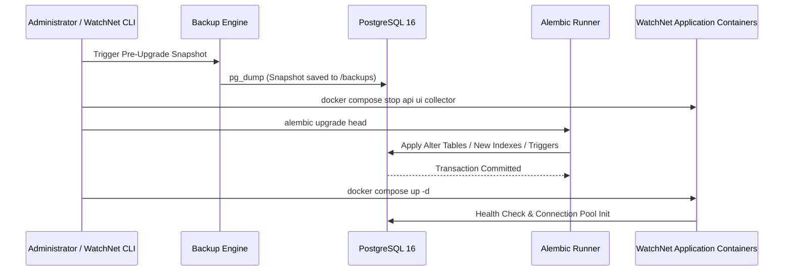

# WatchNet Upgrade and Migration Specification

**Document Version:** 1.0.0  
**Status:** Approved Architecture Standard  
**Migration Engine:** Alembic (PostgreSQL)  
**Compatibility Policy:** Semantic Versioning (SemVer 2.0), Forward/Backward Migration Support  

---

## 1. Upgrade Lifecycle & Zero-Downtime Strategy

Upgrading WatchNet across version releases (e.g. v1.1.0 to v1.2.0) requires preserving historical device intelligence, presence heatmaps, and parental policy configurations without data corruption:
1. **Pre-Upgrade Backup:** Automated point-in-time snapshot of the PostgreSQL database before applying migrations.
2. **Atomic Schema Migrations:** All schema alterations execute inside transactional blocks via Alembic. If a migration step encounters a failure, the transaction rolls back cleanly.
3. **Decoupled Service Rolling Restart:** The database and cache remain operational while the backend and frontend containers update.



---

## 2. Standard Production Upgrade Routine

Execute the following sequential commands on the production host:

```bash
# 1. Navigate to deployment directory
cd /opt/watchnet

# 2. Trigger automated snapshot
docker compose exec -T db pg_dump -U watchnet watchnet_prod | gzip > /opt/watchnet/backups/pre_upgrade_$(date +%Y%m%d_%H%M%S).sql.gz

# 3. Pull new container images
docker compose pull

# 4. Stop application workers to prevent race conditions during schema updates
docker compose stop api ui collector

# 5. Execute database schema migration
docker compose run --rm api alembic upgrade head

# 6. Bring updated stack online
docker compose up -d --remove-orphans

# 7. Verify stack health status
docker compose ps
docker compose exec api curl -f http://localhost:8000/api/health
```

---

## 3. Rollback Procedure

If an upgrade fails health checks or introduces critical regression:
```bash
# 1. Stop all application services
docker compose down

# 2. Revert images in docker-compose.yml or git checkout previous tag
git checkout v1.0.0

# 3. Restore database snapshot
docker compose up -d db
gunzip < /opt/watchnet/backups/pre_upgrade_YYYYMMDD_HHMMSS.sql.gz | docker compose exec -T db psql -U watchnet -d watchnet_prod

# 4. Start previous version services
docker compose up -d
```
