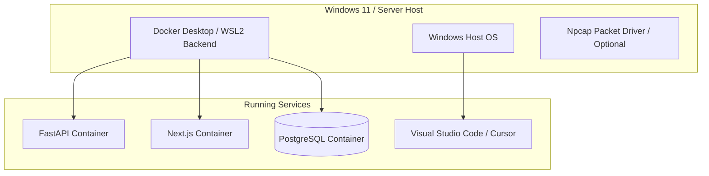

# WatchNet Windows Setup Specification

**Document Version:** 1.0.0  
**Status:** Approved Architecture Standard  
**Operating Systems:** Windows 10 (21H2+), Windows 11, Windows Server 2022  
**Runtimes:** PowerShell 7+, WSL2 (Ubuntu 22.04 LTS), Docker Desktop  

---

## 1. Architectural Scope & Windows Environments

Developing and running WatchNet on Windows environments involves specific considerations regarding raw network packet capture, path separators, and container virtualization:
1. **WSL2 Architecture (Recommended for Development):** Running Docker Desktop with the WSL2 backend provides native Linux syscall semantics, fast file I/O within the WSL filesystem, and standard POSIX networking tools.
2. **Native Windows Host Deployment:** Running the backend and frontend directly on Windows using Python 3.12, Node.js 20, and the Go toolchain.
3. **Network Capture on Windows:** The Go collector uses `Npcap` (with WinPcap compatibility mode) when running natively on Windows, or mock discovery mode when physical L2 access is unneeded.



---

## 2. Step-by-Step Developer Installation

### 2.1 Prerequisites Installation via Winget
Open PowerShell as Administrator:
```powershell
# Install core runtimes and development tools
winget install Python.Python.3.12
winget install OpenJS.NodeJS.LTS
winget install GoLang.Go
winget install Docker.DockerDesktop
winget install Git.Git
```

### 2.2 Clone & Workspace Configuration
```powershell
# Clone the repository
git clone https://github.com/watchnet/watchnet.git D:\WatchNet-Rebuild
cd D:\WatchNet-Rebuild

# Configure line ending safety (prevent CRLF corruption on shell scripts)
git config core.autocrlf input
```

### 2.3 Backend Setup (FastAPI + Python 3.12)
```powershell
cd services\api
python -m venv .venv
.\.venv\Scripts\Activate.ps1
python -m pip install --upgrade pip
pip install -r requirements.txt
pip install -r requirements-dev.txt

# Copy environment template
Copy-Item .env.example .env
```

### 2.4 Frontend Setup (Next.js 15 + pnpm)
```powershell
cd ..\..\apps\web
npm install -g pnpm
pnpm install
pnpm dev
```

---

## 3. Windows-Specific Quirks & Workarounds

- **Path Delimiters:** Always use `pathlib.Path` in Python code and avoid hardcoded forward/backward slash concatenation.
- **Port Conflicts:** Ensure Windows Internet Connection Sharing (ICS) or Hyper-V Reserved Ports do not occupy port 53 or 8000 (`netstat -ano | findstr :8000`).
- **PowerShell Execution Policy:** If running `.venv\Scripts\Activate.ps1` produces a script execution error, run:
  ```powershell
  Set-ExecutionPolicy -ExecutionPolicy RemoteSigned -Scope CurrentUser
  ```
