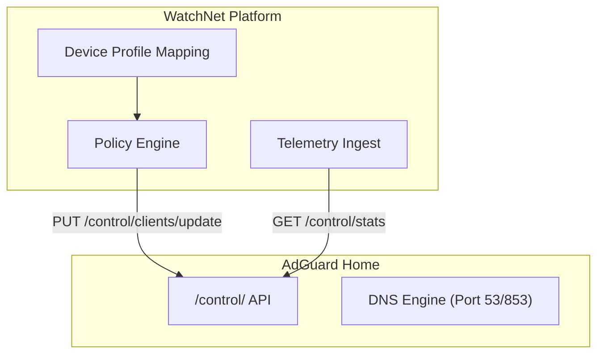

# WatchNet AdGuard Home Integration Specification

**Document Version:** 1.0.0  
**Status:** Approved Architecture Standard  
**Supported Upstream Protocol:** AdGuard Home REST API (`/control/`)  
**Applicability:** Ingest Engine, Parental Control Filtering, DNS Health Monitoring, SafeSearch Enforcement  

---

## 1. Architectural Scope & Operating Modes

AdGuard Home serves as a central DNS filtering and privacy gateway. WatchNet connects to AdGuard Home instances via HTTPS to achieve:
1. **Telemetry & Client Monitoring:** Ingest total DNS queries, blocked tracker/ad counts, and query velocity per client device.
2. **Device-Level Policy Enforcement:** Apply granular parental control rules (SafeSearch, YouTube restricted mode, blocking specific service categories like social media, gaming, or gambling) mapped to WatchNet device profiles.
3. **Local DNS Verification:** Ingest local DNS rewrite rules to cross-check network discovery hostname records.



---

## 2. API Endpoints & Data Exchange Contracts

WatchNet communicates with the AdGuard Home HTTP service using standard Basic Authentication or session cookies.

### 2.1 Polled Ingest Endpoints
- `GET /control/status`: Ingests operational state (protection enabled, DNS server IP, port, upstream latency).
- `GET /control/stats`: Returns aggregated metrics over the configured time window (`time_window` parameter in hours):
  - `num_dns_queries`: Total queries handled.
  - `num_blocked_filtering`: Blocked ad/malware requests.
  - `top_queried_domains`: Top queried FQDNs.
  - `top_blocked_domains`: Top filtered FQDNs.
  - `top_clients`: Array of client IPs with respective query numbers.
- `GET /control/clients`: Fetches configured persistent clients with MAC, IP, tags, and custom blocked services.

### 2.2 Mutation & Policy Enforcement Endpoints
- `POST /control/clients/add` & `POST /control/clients/update`:
  Maps a WatchNet `Profile` to an AdGuard persistent client:
  ```json
  {
    "name": "Child Tablet - iPad Mini",
    "ids": ["192.168.1.145", "bc:d0:74:11:22:33"],
    "use_global_settings": false,
    "filtering_enabled": true,
    "parental_enabled": true,
    "safesearch_enabled": true,
    "safebrowsing_enabled": true,
    "blocked_services": [
      "tiktok",
      "youtube",
      "roblox",
      "discord"
    ],
    "upstreams": []
  }
  ```
- `POST /control/dns_config`: Inspects or verifies global upstream DNS providers.

---

## 3. Client & Identity Reconciler

AdGuard Home allows clients to be identified by either IP address, CIDR subnet, or MAC address (if AdGuard runs on host network with ARP table visibility).

1. **Identifier Synthesis:**
   - WatchNet provides both MAC address and current assigned IP in the AdGuard client `ids` list.
   - If the device renews DHCP with a new IP, WatchNet's DHCP lease listener automatically invokes `POST /control/clients/update` to update the AdGuard client definition, ensuring uninterrupted policy enforcement.
2. **Group Policy Rollup:**
   - WatchNet devices assigned to a "Kids" profile inherit parent profile restrictions.
   - When parental control schedules change (e.g., Bedtime lockout at 21:00), WatchNet toggles `blocked_services` or applies global filtering rules to the profile's member devices.

---

## 4. Configuration Schema

```json
{
  "integration_type": "adguard",
  "site_id": "site_01hw8v3m4q2",
  "name": "Primary AdGuard Gateway",
  "host": "192.168.1.3",
  "port": 3000,
  "use_tls": true,
  "verify_tls": true,
  "username": "watchnet_sync",
  "password": "secret:vault:enc:adguard_password",
  "poll_interval_seconds": 30,
  "sync_interval_clients": 300,
  "manage_policies": true,
  "default_blocked_services": []
}
```

---

## 5. Security & Edge Case Handling

- **Credential Vaulting:** Passwords are stored encrypted using database column-level AES-256-GCM.
- **Circuit Breaker:** If AdGuard returns 5xx errors or connection timeouts, WatchNet pauses policy sync updates for 60 seconds with exponential backoff up to 10 minutes.
- **Fail-Open Isolation:** Device discovery, port scanning, and core network monitoring operate completely independently of the AdGuard integration.
