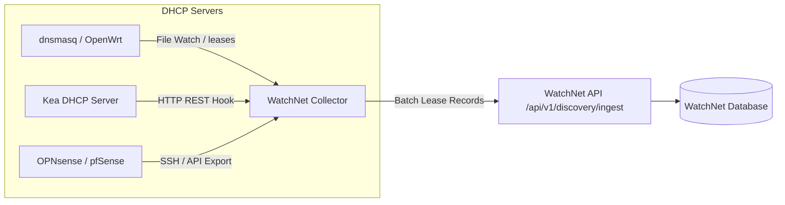

# WatchNet DHCP Integration Specification

**Document Version:** 1.0.0  
**Status:** Approved Architecture Standard  
**Supported Sources:** `dnsmasq.leases`, ISC DHCPd (`dhcpd.leases`), Kea DHCP REST API, MikroTik RouterOS DHCP Leases, OPNsense/pfSense XML/API  
**Applicability:** Fast Sub-Minute Device Discovery, IP-to-MAC Leases, Hostname Extraction  

---

## 1. Architectural Scope & Objectives

DHCP lease inspection provides the fastest, most passive mechanism for detecting devices the instant they join the network—without waiting for periodic active ARP sweeps:
1. **Instant Client Registration:** Captures DHCP `ACK` events or newly written lease records within seconds of lease grant.
2. **Authoritative Hostnames:** Ingests DHCP Client-Identifier (Option 61) and Hostname (Option 12) provided directly by the operating system (e.g., `iPhone-15-Pro`, `Pixel-8`, `Samsung-TV`).
3. **Lease Expiration Awareness:** Detects expired leases and releases IP reservations in WatchNet before active sweep timeouts occur.



---

## 2. Ingestion Modes & Adapters

WatchNet implements three distinct ingestion adapters for DHCP telemetry:

### 2.1 File-Based Lease Monitoring (`dnsmasq` / ISC DHCP)
- **Target File:** `/var/lib/misc/dnsmasq.leases` or `/var/db/dhcpd.leases`.
- **Parsing Strategy:**
  - Standard `dnsmasq` line format: `<expiry_epoch> <mac> <ip> <hostname> <client_id>`.
  - The Go collector watches the file via `inotify` (Linux) or polls the file timestamp every 5 seconds.
  - Generates delta lease events whenever a line changes or is appended.

### 2.2 API-Driven Ingestion (Kea DHCP & Router APIs)
- **Kea Control Agent:** Dispatches `lease4-get-all` command via HTTP JSON-RPC to port 8000:
  ```json
  {"command": "lease4-get-all", "service": ["dhcp4"]}
  ```
  Returns full array of leases including IP, HW address, valid lifetime, and client hostname.
- **RouterOS API / SSH:** Executes `/ip dhcp-server lease print detail without-paging` to extract active static and dynamic leases.

### 2.3 Syslog / Event Stream Hook
- WatchNet can receive RFC-5424 syslog streams from gateways forwarding DHCP logs (`DHCPACK on 192.168.1.50 to bc:d0:74:11:22:33 via eth0`).
- Regex extractor immediately triggers a single-host discovery sweep for that specific IP/MAC pair.

---

## 3. Data Schema & Reconciler Logic

When a DHCP lease event is processed:
1. **Device Identification:** The MAC address is cleaned to lowercase canonical format `aa:bb:cc:dd:ee:ff`.
2. **Conflict Resolution:** If the MAC already exists, the IP address is updated, and the old IP association is moved to historical audit logs.
3. **Hostname Protection:** If the device has `is_name_locked: true` set by an administrator, the DHCP hostname is stored as `raw_dhcp_hostname`, leaving the user-assigned `custom_name` intact on the primary UI display.

---

## 4. Configuration Schema

```json
{
  "integration_type": "dhcp_leases",
  "site_id": "site_01hw8v3m4q2",
  "name": "Local Gateway dnsmasq Monitor",
  "source_mode": "file_monitor",
  "file_path": "/etc/dnsmasq.leases",
  "poll_interval_seconds": 10,
  "default_lease_time_hours": 24,
  "parse_vendor_options": true,
  "trigger_immediate_ping": true
}
```

---

## 5. Security & Isolation

- **Read-Only Ingestion:** The collector mounts or accesses lease files in strict read-only mode (`ro`).
- **Input Sanitization:** Client-supplied hostnames are aggressively sanitized to prevent HTML injection, XSS, or control character corruption before rendering in the Next.js UI or writing to PostgreSQL.
