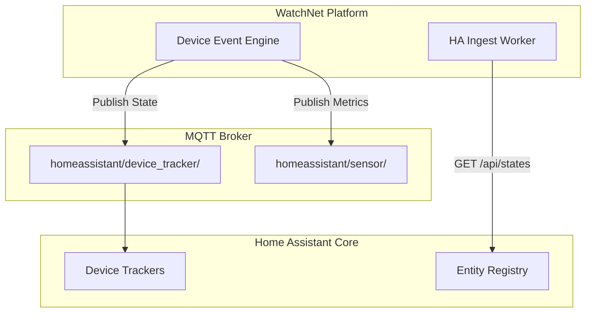

# WatchNet Home Assistant Integration Specification

**Document Version:** 1.0.0  
**Status:** Approved Architecture Standard  
**Integration Methods:** MQTT Auto-Discovery & Home Assistant Core REST/WebSocket API  
**Applicability:** Presence Detection, IoT Device State, Automation Triggers  

---

## 1. Architectural Scope & Operating Modes

WatchNet communicates with Home Assistant (HA) through two complementary communication channels:
1. **MQTT Device Tracker & Sensors (Outbound Auto-Discovery):** WatchNet publishes device presence (`home` / `not_home`), IP shifts, connection speed, and signal metrics via MQTT to Home Assistant's standard discovery prefix (`homeassistant/device_tracker/...`).
2. **REST / WebSocket Ingestion (Inbound Entity Telemetry):** WatchNet queries Home Assistant's API using a Long-Lived Access Token to ingest IoT device entities, battery levels, Zigbee/Z-Wave node states, and device areas/rooms.



---

## 2. MQTT Auto-Discovery Protocol Contract

When WatchNet is configured with an MQTT broker shared with Home Assistant:

### 2.1 Device Tracker Discovery Payload
- **Topic:** `homeassistant/device_tracker/watchnet_{mac_clean}/config`
- **Payload:**
  ```json
  {
    "name": "MacBook Pro M3",
    "unique_id": "watchnet_dev_bc2411223344",
    "state_topic": "watchnet/device/bc2411223344/presence",
    "payload_home": "home",
    "payload_not_home": "not_home",
    "json_attributes_topic": "watchnet/device/bc2411223344/attributes",
    "source_type": "router",
    "icon": "mdi:laptop",
    "device": {
      "identifiers": ["watchnet_bc2411223344"],
      "name": "MacBook Pro M3",
      "manufacturer": "Apple, Inc.",
      "model": "Network Client",
      "via_device": "watchnet_hub"
    }
  }
  ```

### 2.2 Live State & Attribute Publishing
- **State Topic (`watchnet/device/{mac}/presence`):** `home` when active or seen within timeout; `not_home` when expired.
- **Attributes Topic (`watchnet/device/{mac}/attributes`):**
  ```json
  {
    "ip_address": "192.168.1.150",
    "hostname": "John-MacBook.local",
    "site_name": "Home Main",
    "interface": "eth0",
    "connection_type": "wifi",
    "rssi": -58,
    "last_seen": "2026-11-12T09:30:00Z"
  }
  ```

---

## 3. Home Assistant Core REST API Client

WatchNet interacts with Home Assistant Core directly for entity enrichment:
- **Authentication:** HTTP Header `Authorization: Bearer <LONG_LIVED_ACCESS_TOKEN>`.
- **Endpoints Polled:**
  - `GET /api/`: Connectivity and health verification.
  - `GET /api/states`: Pulls all entity states. WatchNet filters for `device_tracker.*`, `sensor.*_battery`, and `light.*` to correlate physical IoT devices with network IP/MAC leases.
  - `POST /api/services/persistent_notification/create`: Dispatches security or rogue device alerts into the Home Assistant notification center.

---

## 4. Configuration Schema

```json
{
  "integration_type": "home_assistant",
  "site_id": "site_01hw8v3m4q2",
  "name": "Home Assistant Production",
  "ha_url": "http://192.168.1.5:8123",
  "access_token": "secret:vault:enc:ha_access_token",
  "enable_rest_enrichment": true,
  "mqtt_enabled": true,
  "mqtt_broker_host": "192.168.1.5",
  "mqtt_broker_port": 1883,
  "mqtt_username": "watchnet_mqtt",
  "mqtt_password": "secret:vault:enc:mqtt_pass",
  "mqtt_discovery_prefix": "homeassistant",
  "presence_timeout_minutes": 5
}
```

---

## 5. Security & Isolation Controls

- **Token Protection:** Long-lived tokens and MQTT passwords are encrypted at rest using AES-256-GCM.
- **Controlled Outbound Access:** All HTTP requests to Home Assistant are routed through WatchNet's anti-SSRF egress layer; internal LAN IPs are explicitly whitelisted per integration instance.
- **Resilience:** If Home Assistant is rebooted or MQTT disconnects, WatchNet's Paho client automatically reconnects with backoff and re-publishes device states upon reconnection.
