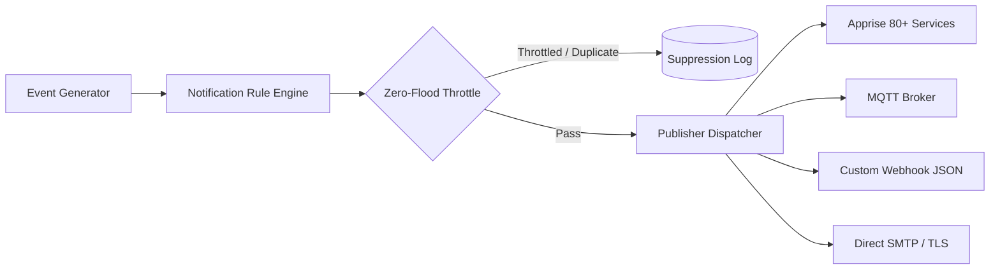

# WatchNet Notification Integrations Specification

**Document Version:** 1.0.0  
**Status:** Approved Architecture Standard  
**Engines:** Native Apprise Engine, MQTT Broker, Native Webhook Publisher, SMTP Client  
**Applicability:** Alert Delivery, Zero-Flood Throttling, High-Availability Dispatch  

---

## 1. Architectural Scope & Delivery Pipeline

The WatchNet Notification Engine is responsible for delivering real-time, event-driven alerts regarding network activities (e.g., New Device Discovered, Gateway IP Changed, Rogue AP Detected, Device Offline/Online, Down Alert).



---

## 2. Supported Delivery Channels

WatchNet provides built-in support for all legacy upstream notification services via dual-dispatch capabilities:

1. **Apprise Multi-Service Engine (80+ Providers):**
   - **Telegram:** `tgram://{bot_token}/{chat_id}`
   - **Discord:** `discord://{webhook_id}/{webhook_token}`
   - **Pushover:** `pover://{user_key}@{app_token}`
   - **Pushsafer:** `psaf://{private_key}`
   - **ntfy.sh:** `ntfy://{topic}`
   - **Slack:** `slack://{token_a}/{token_b}/{token_c}`
   - **Signal / Gotify / Mattermost / Teams**
2. **Native Webhook Publisher:**
   - Sends configurable JSON or form payloads with customizable headers (HMAC signatures, bearer tokens, or custom auth headers).
3. **Home Assistant MQTT Publisher:**
   - Emits alerts to `watchnet/events/alerts` with QoS 1 and retained message flags for automation triggers.
4. **Direct SMTP / Secure Email:**
   - Supports STARTTLS and implicit TLS (Port 465 / 587) with HTML template rendering and device snapshot summaries.

---

## 3. Zero-Flood Throttling & Deduplication

To prevent alert fatigue and notification storms during network outages or Wi-Fi beacon flapping, WatchNet enforces:
- **Deduplication Key:** Hash of `(tenant_id, site_id, device_id, event_type)`.
- **Sliding Throttle Window:** Configurable default of 300 seconds (5 minutes). If 15 "Device Disconnected" events occur within 3 minutes for a single flapping device, only the first event is dispatched immediately.
- **Summary Digest Rollup:** Subsequent suppressed events are consolidated and emitted as a single digest update when the flapping stabilizes.

---

## 4. Configuration Schema

```json
{
  "channel_id": "chan_01hw8v3m4q2",
  "tenant_id": "org_default",
  "name": "Ops Telegram Channel",
  "channel_type": "apprise",
  "target_url": "tgram://123456789:ABCdefGHIjklMNOpqrsTUVwxyz/-100123456789",
  "enabled": true,
  "throttle_window_seconds": 300,
  "min_severity": "WARNING",
  "event_filters": [
    "DEVICE_NEW",
    "DEVICE_DOWN",
    "IP_CONFLICT",
    "PARENTAL_SCHEDULE_BLOCK"
  ]
}
```

---

## 5. Security & Secret Protection

- **URL & Token Masking:** All webhook URLs, bot tokens, and SMTP passwords contain sensitive credentials and are stored encrypted at rest with AES-256-GCM.
- **Egress Hardening:** Webhooks destined for external URLs are validated against private IP blocklists to prevent SSRF vulnerabilities unless the channel is explicitly marked `allow_internal_lan: true`.
