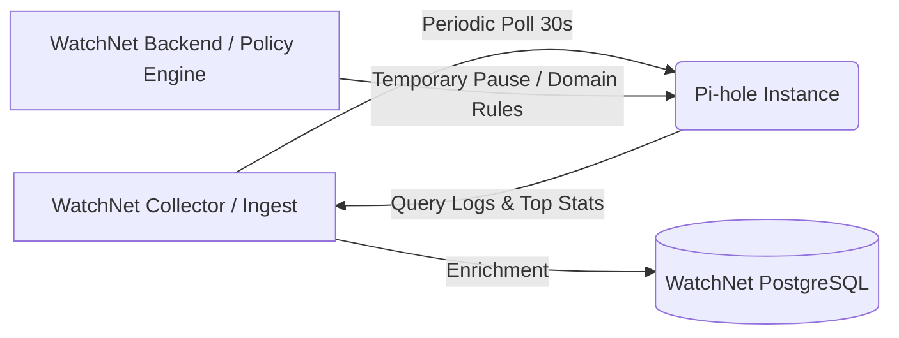

# WatchNet Pi-hole Integration Specification

**Document Version:** 1.0.0  
**Status:** Approved Architecture Standard  
**Supported Upstream Versions:** Pi-hole v5 (FTL/PHP web API `api.php`) & Pi-hole v6 (REST API v1/v2)  
**Applicability:** Ingest Engine, Parental Control Domain Policies, DNS Health Monitoring  

---

## 1. Architectural Scope & Operating Modes

WatchNet integrates with one or more network Pi-hole instances to accomplish two core objectives:
1. **Network Intelligence & Device Profiling (Read-Only):** Correlate Pi-hole query statistics, top blocked domains, and client query volumes with WatchNet-discovered MAC and IP addresses.
2. **DNS-Based Policy Enforcement & Diagnostics (Controlled Mutations):** Allow administrative and parental control workflows to inspect blacklist status, trigger temporary blocking pauses, or register domain restrictions per device profile.



---

## 2. Protocol & Version Compatibility

### 2.1 Pi-hole v5 Protocol Specification
- **Base Endpoint:** `http(s)://<pihole-host>:<port>/admin/api.php`
- **Authentication:** Token-based query parameter `auth=<WEBPASSWORD_SHA256_HASH>` (or unauthenticated for top summary metrics).
- **Core Endpoints Polled:**
  - `?summaryRaw`: Total queries, queries forwarded, ads blocked today, percentage blocked, active domains in blocklist.
  - `?topItems=25&auth={token}`: Top permitted domains and top blocked queries.
  - `?topClients=50&auth={token}`: Client IP addresses with query counts.
  - `?disable={seconds}&auth={token}`: Pause blocking temporarily for diagnostic maintenance.
  - `?enable&auth={token}`: Re-enable blocking immediately.

### 2.2 Pi-hole v6 Protocol Specification
- **Base Endpoint:** `http(s)://<pihole-host>:<port>/api/`
- **Authentication:** HTTP Header `sid: <session-id>` obtained via `POST /api/auth` with JSON password payload, or long-lived API app password.
- **Core Endpoints Polled:**
  - `GET /api/stats/summary`: Aggregate counts, real-time query velocities.
  - `GET /api/stats/top/domains`: Filtered top domain metrics.
  - `GET /api/stats/top/clients`: Client query distributions.
  - `POST /api/dns/blocking`: Payload `{"blocking": false, "timer": 300}` for timed disable.

---

## 3. Data Ingestion & Entity Correlation Model

Pi-hole logs clients exclusively by IP address (or configured reverse DNS name). WatchNet correlates these entries to persistent hardware devices via its multi-interface IP-to-MAC mapping pipeline:

1. **Client Resolution:**
   - Ingest extracts client IP `192.168.1.105`.
   - WatchNet resolves `192.168.1.105` against `network_interfaces` table for the matching Site ID.
   - The query volume and blocked count are recorded against `device_metrics_hourly` tied to `device_id`.
2. **Handling DHCP Churn & IP Shifts:**
   - Because IP leases change, Pi-hole historical metrics are bucketed into hourly rollups indexed by `(device_id, site_id, timestamp)`.
   - If an IP was associated with Device A from 08:00 to 11:00 and Device B from 11:01 to 14:00, WatchNet segments DNS activity records across the respective device lifetimes.

---

## 4. Configuration Schema

The Pi-hole adapter configuration is stored encrypted in `integration_instances` table:

```json
{
  "integration_type": "pihole",
  "site_id": "site_01hw8v3m4q2",
  "name": "Primary LAN Pi-hole",
  "host": "192.168.1.2",
  "port": 80,
  "use_tls": false,
  "verify_tls": false,
  "api_version": "v5",
  "auth_token": "secret:vault:enc:pihole_api_token",
  "poll_interval_seconds": 30,
  "enable_query_logging": true,
  "top_items_limit": 25,
  "sync_clients": true
}
```

---

## 5. Security, Failure Modes & Resilience

- **TLS & Token Protection:** Tokens are encrypted at rest using AES-256-GCM in the backend database.
- **Fail-Open Policy:** If the Pi-hole instance becomes unreachable, WatchNet flags the integration status as `DEGRADED`, issues an operator warning, but **does not interrupt device discovery or router ARP sweeps**.
- **Rate Limiting & Low Footprint:** Polling is throttled to 30s minimum intervals. Batch imports parse response streams with memory limits to prevent OOM when reading extensive client lists.
