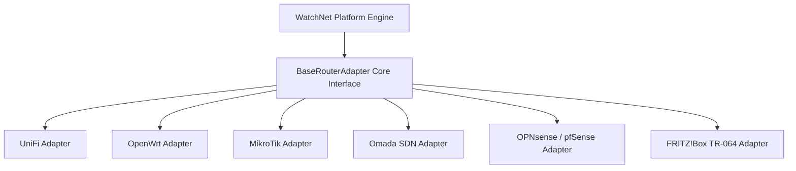

# WatchNet Supported Routers Specification

**Document Version:** 1.0.0  
**Status:** Approved Architecture Standard  
**Architecture:** Multi-Vendor Hardware Abstraction Layer  

---

## 1. Design Philosophy: Hardware Independence

WatchNet is deliberately designed without vendor lock-in. Rather than tying its discovery, presence, and network intelligence to a single proprietary brand or router model, WatchNet establishes a vendor-agnostic architecture:
- Core discovery works with **zero router access** via autonomous Go collectors performing local raw-socket sweeps, ARP inspection, and ICMP/TCP probes.
- When an administrator configures credentials for a supported gateway or router, WatchNet enhances device records with hardware-level metrics (e.g., exact switch port, Wi-Fi channel, RSSI, DHCP leases).

---

## 2. Supported Vendor Profiles & Implementation Blueprints

### 2.1 Ubiquiti UniFi Ecosystem
- **Hardware Supported:** Dream Machine (UDM/UDM-Pro/UDM-SE), UniFi Express, Gateway Lite (UXG), Cloud Key Gen2+, Self-Hosted UniFi Network Applications.
- **Connection Interface:** HTTPS REST API (`/api/s/{site}/...` or UniFi OS proxy `/proxy/network/api/...`).
- **Telemetry Ingested:** Access Point BSSID, client RSSI, link speed, channel, Tx/Rx byte counters, PoE power usage, switch port numbers.
- **Parental & Host Actions:** Client firewall rule generation and traffic isolation via API.

### 2.2 OpenWrt & Embedded Linux Gateways
- **Hardware Supported:** Any router running OpenWrt 21.02, 22.03, 23.05+, GL.iNet travel routers, Turris Omnia.
- **Connection Interface:** `ubus` JSON-RPC over HTTPS or authenticated SSH commands.
- **Commands Executed:**
  - `ubus call hostapd.<interface> get_clients`: Live Wi-Fi associations with signal and rate.
  - `cat /tmp/dhcp.leases`: Active dnsmasq lease table.
  - `ip neigh show`: Kernel ARP/NDP cache.
  - `nft list table inet fw4`: Inspect active firewall rules.

### 2.3 MikroTik RouterOS
- **Hardware Supported:** RouterBOARD, hEX, hAP, RB5009, CCR series running RouterOS v6.48+ or v7.x.
- **Connection Interface:** RouterOS REST API (port 443 / 80) or binary API (port 8728).
- **Telemetry Ingested:** `/ip/dhcp-server/lease`, `/ip/arp`, `/interface/wireless/registration-table`, `/interface/traffic-monitor`.

### 2.4 TP-Link Omada SDN
- **Hardware Supported:** Omada Hardware Controller (OC200, OC300), Software Controller, Cloud Gateway (ER605, ER7206).
- **Connection Interface:** Omada Open API via OAuth token exchange.
- **Telemetry Ingested:** Site client lists, AP channel assignment, switch port status.

### 2.5 OPNsense & pfSense Firewall Appliances
- **Hardware Supported:** OPNsense 23.x/24.x, pfSense Community Edition / pfSense Plus.
- **Connection Interface:** OPNsense REST API (`/api/diagnostics/interface/getArpTable`, `/api/dhcpv4/leases/searchLease`) and pfSense FauxAPI / XML-RPC.
- **Telemetry Ingested:** ARP cache, DHCP lease status, gateway latency, CARP redundancy state.

### 2.6 Consumer Gateways (ASUSWRT, FRITZ!Box, Freebox)
- **ASUSWRT (Stock / Merlin):** SSH-based `nvram` queries and `wl assoclist` extraction.
- **AVM FRITZ!Box:** TR-064 SOAP protocol over HTTPS (Port 49443) querying `Hosts:1` service (`X_AVM-DE_GetHostListPath`).
- **Freebox:** Freebox OS REST API v8+ with HMAC-SHA1 session tokens.

---

## 3. Integration Lifecycle & Safety Guidelines

1. **Read-Only Registration by Default:** New routers are always added with strict read-only rights. Mutating actions (such as kicking clients or blocking MACs) require explicit multi-factor verification by a `SUPER_ADMIN`.
2. **Fail-Open Policy:** If a router goes offline, loses management access, or rejects API requests, WatchNet flags the router as `UNAVAILABLE` and seamlessly continues discovery using passive network scanning.
