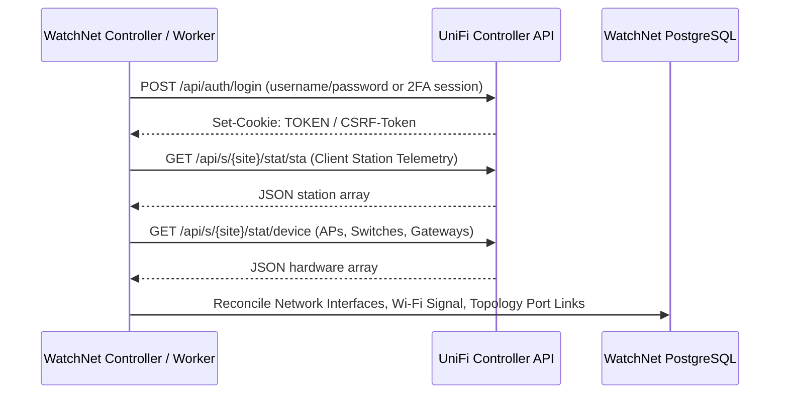

# WatchNet UniFi Integration Specification

**Document Version:** 1.0.0  
**Status:** Approved Architecture Standard  
**Target Platform:** Ubiquiti UniFi Network Application (Cloud Key, UDM/UDR, Self-Hosted Docker/Debian)  
**Supported API Versions:** UniFi Controller v7.x, v8.x  

---

## 1. Architectural Scope & Objectives

WatchNet integrates with UniFi Network controllers to ingest enterprise-grade Wi-Fi and switching telemetry. This integration supplies:
1. **L2/L3 Physical Topology:** Exact switch port mapping, VLAN IDs, and link speeds (100M/1G/2.5G/10G) for wired devices.
2. **Wireless Client Telemetry:** Connected Access Point (AP), BSSID, SSID, Radio Band (2.4GHz / 5GHz / 6GHz), Channel, RSSI (dBm), PHY rate (Tx/Rx Mbps), and Wi-Fi Generation (Wi-Fi 5/6/7).
3. **Hardware Health & Adoption State:** Gateway status, AP connection counts, firmware versions, and switch PoE power budgets.



---

## 2. Authentication & Session Management

- **Endpoint:** `POST https://<unifi-host>:<port>/api/auth/login`
- **Payload:** `{"username": "<service-account>", "password": "<password>", "remember": true}`
- **Session Handling:**
  - Modern UniFi OS (UDM/UDR/UXG on UniFi OS 3.x/4.x) utilizes `https://<unifi-host>/api/auth/login` and proxies requests through `/proxy/network/api/s/{site}/...`.
  - Classic self-hosted controllers utilize `https://<unifi-host>:8443/api/login` and direct `/api/s/{site}/...` routes.
  - WatchNet auto-detects controller type by inspecting HTTP response headers and redirects.
  - Authentication cookies (`TOKEN`) and CSRF headers (`X-CSRF-Token`) are cached in Redis with a 2-hour TTL and refreshed proactively.

---

## 3. Data Extraction & Entity Normalization

### 3.1 Client Station Telemetry (`/api/s/{site}/stat/sta`)
Extracted fields are mapped directly to WatchNet models:
- `mac` -> `network_interfaces.mac_address`
- `ip` -> `network_interfaces.ip_address`
- `hostname` / `name` -> `devices.hostname` (unless user locked)
- `is_wired` -> Flag determining wireless vs. wired path
- `ap_mac` / `bssid` -> Access Point identification
- `essid` -> Connected Wi-Fi SSID
- `channel` & `radio_proto` -> Radio band and protocol
- `signal` & `rssi` -> Signal metrics stored in `device_telemetry`
- `rx_bytes`, `tx_bytes` -> Bandwidth counters
- `sw_mac`, `sw_port` -> Switch MAC and port index for wired topology

### 3.2 Device & Infrastructure Telemetry (`/api/s/{site}/stat/device`)
- Maps UniFi hardware into WatchNet `network_nodes` infrastructure records:
  - Model string (e.g., `U6-Pro`, `USW-24-PoE`, `UDM-SE`)
  - Firmware version and upgrade status
  - PoE budget consumption (Watts used vs. Total Watts)
  - Port operational state (Up, Down, Disabled, Link Speed)

---

## 4. Configuration Schema

```json
{
  "integration_type": "unifi",
  "site_id": "site_01hw8v3m4q2",
  "name": "Headquarters UniFi Controller",
  "host": "192.168.1.1",
  "port": 443,
  "unifi_site_name": "default",
  "is_unifi_os": true,
  "use_tls": true,
  "verify_tls": false,
  "username": "watchnet_svc",
  "password": "secret:vault:enc:unifi_svc_password",
  "poll_interval_seconds": 60,
  "sync_infrastructure": true,
  "enrich_wifi_metrics": true
}
```

---

## 5. Security & Operational Hardening

- **Principle of Least Privilege:** UniFi administrator role is assigned as "Read Only" on the target UniFi site. No write/management permissions are required for network monitoring.
- **TLS Handshake Tolerances:** Self-hosted controllers frequently use self-signed certificates. WatchNet supports user-provided CA certificate bundles or explicit `verify_tls: false` with audit warnings.
- **Fail-Safe Operation:** If UniFi API becomes unavailable, device records retain their last known connection topology, marked with an `is_stale: true` flag after 15 minutes.
