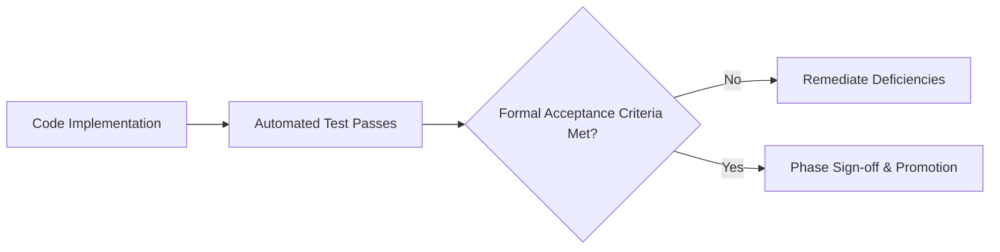

# WatchNet Acceptance Criteria Specification

**Document Version:** 1.0.0  
**Status:** Approved Architecture Standard  
**Mandatory Phase Gates:** Acceptance Standards for Phases 1 to 11  

---

## 1. Acceptance Framework & Philosophy

Acceptance in WatchNet is objective and verifiable. A phase is not complete simply because an agent generated code or mocked a test pass. Every phase must fulfill explicit, measurable acceptance criteria before proceeding to the next stage.

---

## 2. Phase-by-Phase Acceptance Gates

### Phase 1: Architecture & Documentation Acceptance
- [x] All 77 required documents authored in `D:\WatchNet-Rebuild\docs` and root.
- [x] Zero empty or truncated stub files (<25 lines) across the documentation tree.
- [x] System architecture, database ERD, sequence diagrams, and interface contracts specified with Mermaid charts.
- [x] `FEATURE_PARITY_MATRIX.md` maps 100% of the 56 NetAlertX upstream plugins with initial `NOT_STARTED` baseline status.

### Phase 2: Core Platform Acceptance
- [ ] Docker Compose stack boots `api`, `ui`, `collector`, `db`, `redis`, and `caddy` cleanly.
- [ ] Initial database migration applies all tables, indexes, and RLS policies with zero errors.
- [ ] Authentication endpoints issue valid JWT tokens; `/auth/me` returns user profile and permissions.
- [ ] Non-root execution verified: `docker inspect` confirms containers run as `uid: 10001`.

### Phase 3: Discovery Engine Acceptance
- [ ] Go collector sends valid unicast ARP queries and extracts active MAC/IP bindings.
- [ ] Passive mDNS listener correctly extracts hostnames from test Apple/Google devices.
- [ ] Ingest endpoint validates HMAC-SHA256 signatures; rejects unauthorized payloads.
- [ ] Offline queue drain: Collector queues observations when API is stopped and flushes when restarted.

### Phase 4: Device Intelligence Acceptance
- [ ] Changing a device's IP updates `network_interfaces` and creates an audit entry in `device_ip_history`.
- [ ] User-locked attributes (`is_name_locked: true`) resist overwriting from discovery sweeps.
- [ ] 24-hour presence heatmap calculates online minutes across 24 hourly buckets.

### Phase 5: Monitoring & Topology Acceptance
- [ ] Continuous ICMP/TCP checks detect down hosts within 30 seconds.
- [ ] Topology map links devices to parent switch ports and wireless AP BSSIDs.

### Phase 6: Plugin Framework Acceptance
- [ ] Plugin runner executes Python plugins in sandboxed subprocesses with CPU/memory limits.
- [ ] Test runs for each of the 56 cataloged plugins complete and return standardized JSON.

### Phase 7: Notifications Acceptance
- [ ] Test alerts dispatch to configured Apprise channels (Telegram, Discord, ntfy).
- [ ] 5-minute sliding window suppresses duplicate notifications during network flapping.

### Phase 8: API & Multi-Site Acceptance
- [ ] OpenAPI 3.1 schema validates with zero Schemathesis fuzzing 500 errors.
- [ ] Remote collector registers with sync hub via mTLS and forwards observations.

### Phase 9: Router & Family Safety Acceptance
- [ ] UniFi, OpenWrt, and MikroTik test doubles return client lists and Wi-Fi metrics.
- [ ] Bedtime lockout schedules toggle DNS filtering rules on exact minute boundaries.
- [ ] Router failures fail-open without disabling passive network scanning.

### Phase 10: Production Hardening Acceptance
- [ ] Database backup snapshot restores onto an empty database with 100% record parity.
- [ ] Stack recovers gracefully from unexpected host reboots and network drops.

### Phase 11: Final Acceptance
- [ ] Physical manual testing completed per `MANUAL_TESTING_PLAN.md` with mobile phones and real LAN clients.
- [ ] Signed acceptance report approved.
