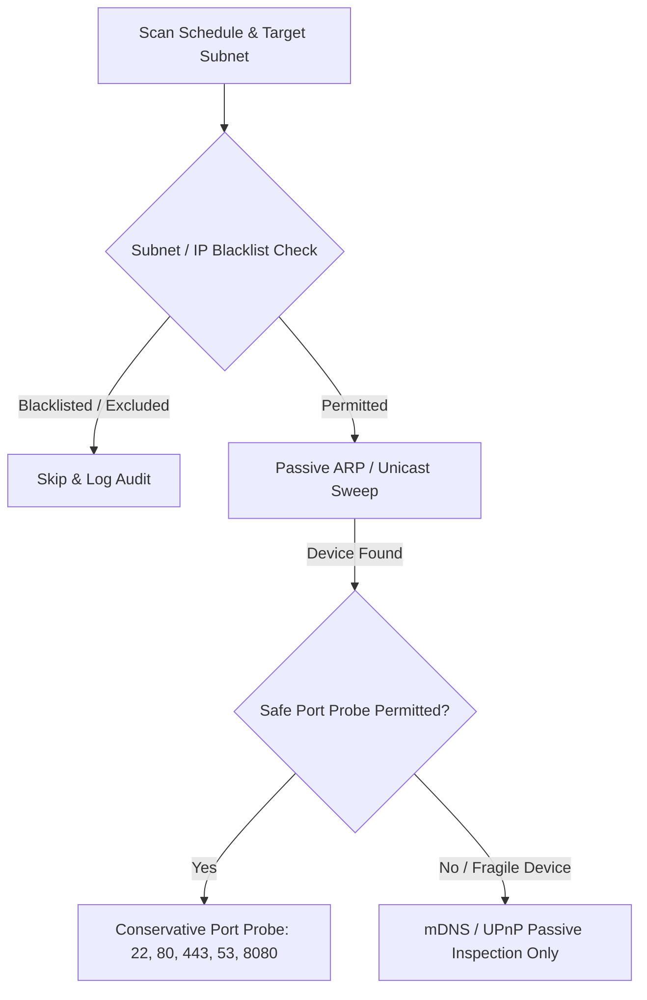

# WatchNet Network Scanner Security Specification

**Document Version:** 1.0.0  
**Status:** Approved Architecture Standard  
**Components:** Go Discovery Collector, ARP/ICMP Sweepers, TCP Probes, Packet Analyzers  

---

## 1. Scanner Operating Boundaries & Safety Philosophy

Network scanning carries intrinsic operational risks if executed improperly: fragile IoT devices, micro-controllers, or printers may crash when subjected to high-concurrency port sweeps, non-standard TCP flags, or malformed packets.

WatchNet strictly enforces a **"First, Do No Harm"** scanning policy:
1. **Passive Sniffing & ARP Sweeps First:** Discovery prioritizes passive traffic analysis (listening to mDNS, DHCP requests, ARP broadcasts) and non-invasive unicast ARP queries.
2. **Rate-Controlled Probing:** TCP and ICMP probes are rate-limited per target IP to prevent denial-of-service on embedded micro-controllers.
3. **Excluded Subnet & IP Blacklists:** Scanners can be configured with strict exclusions (e.g., medical devices, ICS/SCADA controllers, production servers) that are permanently bypassed.



---

## 2. Least Privilege Container & Host Security

The WatchNet Go Collector interacts with host raw sockets while maintaining strict container isolation:
- **Non-Root Execution:** Container runs as user `watchnet` (`uid: 10001`, `gid: 10001`).
- **Capability Constraints:** The container is stripped of all default capabilities and granted only the minimum necessary Linux capabilities:
  ```yaml
  cap_drop:
    - ALL
  cap_add:
    - NET_RAW      # Required for raw socket ARP and ICMP generation
    - NET_BIND_SERVICE
  security_opt:
    - no-new-privileges:true
  read_only: true
  ```
- **Read-Only Root Filesystem:** Root container filesystem is mounted read-only; transient scan buffers reside solely in an unprivileged `tmpfs` volume with `noexec,nosuid,nodev` flags.

---

## 3. Anti-Flood & Network Politeness Parameters

| Parameter | Default Value | Hard Limit | Purpose |
|---|---|---|---|
| **ARP Sweep Rate** | 50 packets/sec | 250 packets/sec | Prevents saturation of Wi-Fi access point airtime |
| **TCP Port Concurrency** | 5 simultaneous targets | 20 simultaneous | Prevents running out of host ephemeral socket file descriptors |
| **Probe Timeout** | 800 ms | 3000 ms | Discards unanswered packets without hanging scanner workers |
| **Fragile Mode** | Auto-detected (ESP8266/ESP32, printers) | Enforced | Disables active port scanning completely for sensitive hardware |

---

## 4. Anti-Tampering & Scanner Egress Security

1. **Ingest Payload Authentication:** Every batch sent from the collector to the WatchNet API carries an HMAC-SHA256 signature in the `X-WatchNet-Signature` header, signed with a shared cluster secret.
2. **SSRF Guard:** The collector only scans subnets explicitly authorized by the administrator during site registration (e.g., `192.168.1.0/24`). Any attempt to probe loopback (`127.0.0.0/8`), link-local metadata (`169.254.169.254`), or cross-site unauthorized subnets is rejected.
