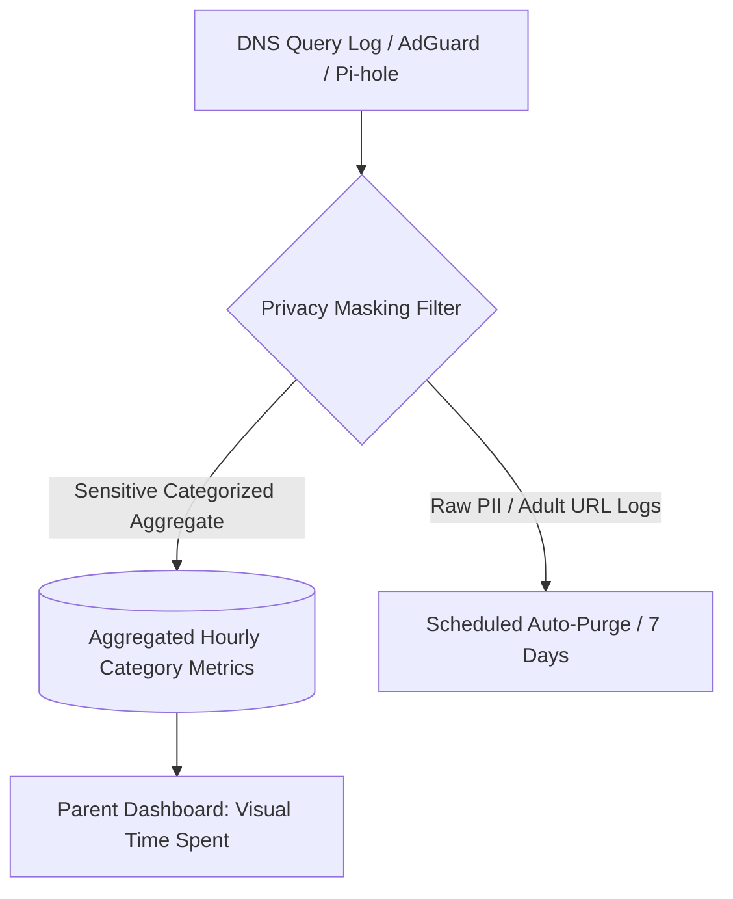

# WatchNet Parental Control Privacy Specification

**Document Version:** 1.0.0  
**Status:** Approved Architecture Standard  
**Compliance Standards:** Children's Online Privacy Protection Act (COPPA), GDPR-K Principles, Privacy-by-Design  

---

## 1. Ethical Principles & Privacy Baseline

WatchNet incorporates family safety and parental oversight capabilities while adhering to strict ethical privacy standards. The primary goal is safeguarding minors against malicious online content and managing healthy screen time, **without turning the home network into an unconstrained surveillance platform**.

### Core Tenets:
1. **Local Data Sovereignity:** All parental control metadata, domain categories, and activity metrics reside exclusively on the user's self-hosted instance. No child activity telemetry is ever forwarded to cloud vendors, telemetry brokers, or upstream servers.
2. **Category Aggregation Over Raw URL Snooping:** WatchNet tracks DNS domain queries and coarse category rollups (e.g., "Social Media", "Gaming", "Adult"), rather than inspecting full HTTPS packet payloads or decrypting TLS browser traffic.
3. **Transparent Notification:** Children's device profiles support optional parental transparency notices, informing users of active schedule policies.

---

## 2. Data Minimization & Retention Tiers

| Data Type | Retention Window | Storage Representation | Access Authorization |
|---|---|---|---|
| **Domain Query Logs** | 7 days (rolling) | Truncated FQDN (`*.example.com`) | `SUPER_ADMIN` Only |
| **Category Usage Rollups** | 30 days (rolling) | Hourly integer minutes per category | `SUPER_ADMIN` / `OPERATOR` |
| **Active Bedtime Lockout History** | 90 days | Scheduled Start / End Timestamps | All Family Profile Members |
| **Bypassed / Blocked Alerts** | 14 days | Event count & target device ID | `SUPER_ADMIN` |

---

## 3. Privacy Masking & Redaction Controls

1. **Differential Privacy Masking:**
   - Administrators can enable "Strict Privacy Mode" for teenage profiles.
   - When active, individual domain names are obfuscated (e.g., `reddit.com` is displayed merely as `[Social Media Category]`), preserving screen-time accounting while protecting personal search privacy.
2. **Instant History Wipe:**
   - Profile management includes a "Purge Profile Activity" function that executes a cascaded deletion of all associated DNS query logs and hourly rollups within 1 second.
3. **Cryptographic Salt per Profile:**
   - Profiling tokens and anonymized identifier hashes use distinct random salts per profile to prevent cross-profile data correlation.

---

## 4. Technical Constraints on Deep Inspection

WatchNet explicitly **does not**:
- Install root CA certificates on children's devices to execute Man-in-the-Middle (MitM) TLS decryption.
- Keylog, screenshot, or inspect encrypted messaging applications (WhatsApp, Signal, iMessage).
- Inspect HTTP request bodies or search query strings.
Enforcement is achieved strictly at the network layer via DNS resolution manipulation and gateway firewall schedules.
