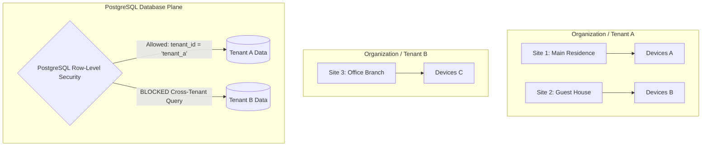

# WatchNet Tenant Isolation Specification

**Document Version:** 1.0.0  
**Status:** Approved Architecture Standard  
**Isolation Architecture:** Logical Multi-Tenancy via PostgreSQL Row-Level Security (RLS)  
**Applicability:** Multi-Site Installations, MSP Deployments, Shared Community Hubs  

---

## 1. Architectural Model & Boundary Definitions

WatchNet supports both standalone single-home installations and multi-tenant deployments (e.g., Managed Service Providers, multi-property real estate, enterprise branch offices). In multi-tenant mode:
- **Tenant Entity:** The root ownership entity (Organization / Household).
- **Site Entity:** A physical network location (e.g., "Main Home", "Vacation House", "Office LAN") belonging to exactly one Tenant.
- **Resource Ownership:** All devices, alerts, network scans, integrations, and parental profiles are scoped to a specific `tenant_id`.



---

## 2. Row-Level Security (RLS) Implementation Contract

WatchNet enforces tenant boundaries at the database kernel level using PostgreSQL Row-Level Security (RLS). This prevents bugs in application application code or ORM queries from leaking data across tenants.

### 2.1 Database Policy Contract
Every tenant-scoped table contains a `tenant_id UUID NOT NULL` column indexed with `btree (tenant_id, id)`.

```sql
-- Enable RLS on core tables
ALTER TABLE devices ENABLE ROW LEVEL SECURITY;
ALTER TABLE alerts ENABLE ROW LEVEL SECURITY;
ALTER TABLE integrations ENABLE ROW LEVEL SECURITY;

-- Enforce tenant isolation policy
CREATE POLICY tenant_isolation_policy ON devices
    FOR ALL
    TO watchnet_app
    USING (tenant_id = NULLIF(current_setting('app.current_tenant_id', true), '')::UUID)
    WITH CHECK (tenant_id = NULLIF(current_setting('app.current_tenant_id', true), '')::UUID);
```

### 2.2 Connection Session Context Setting
Before executing any ORM query or transaction, the FastAPI backend database middleware sets the session variable:
```python
async def set_tenant_context(session: AsyncSession, tenant_id: str):
    await session.execute(
        text("SET LOCAL app.current_tenant_id = :tenant_id"),
        {"tenant_id": tenant_id}
    )
```
If an unprivileged query attempts to access a record where `tenant_id` does not match the active session variable, PostgreSQL silently filters the rows or rejects the insert with a violation error.

---

## 3. Super-Admin & Cross-Tenant Oversight

- **`SUPER_ADMIN` Role:** Platform super-administrators can switch tenant context explicitly by issuing an HTTP header `X-Target-Tenant-Id: <uuid>`, provided their JWT contains the `sys:tenant_switch` permission.
- **Audit Logging:** Every tenant context switch is immutably logged in `audit_logs` with the actor's root credentials, source IP, and justification.
- **Data Cleanup & Tenant Deletion:** Deleting a tenant cascades through all dependent sites, devices, and history records atomically within an isolated transaction.
