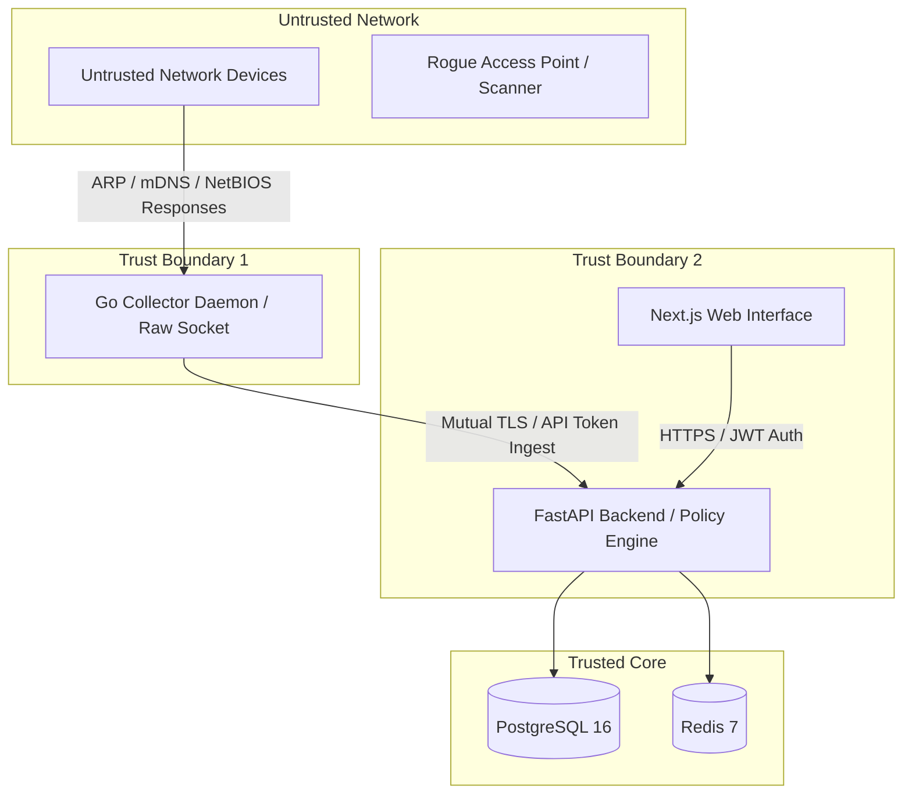

# WatchNet Threat Model

**Document Version:** 1.0.0  
**Status:** Approved Architecture Standard  
**Framework:** STRIDE Methodology & OWASP Top 10  
**Scope:** Distributed Network Collector, API Backend, Next.js UI, Database, Redis Queue  

---

## 1. System Threat Landscape & Trust Boundaries

The WatchNet architecture spans three distinct trust zones:
- **Untrusted Zone (Scanned Local Network):** Arbitrary IoT devices, laptops, mobile phones, potentially compromised guest network clients.
- **Semi-Trusted Zone (Internal Services & Management Interfaces):** Gateway routers, DNS servers (AdGuard, Pi-hole), Home Assistant, remote collector daemons.
- **Trusted Zone (Core Data Plane):** WatchNet FastAPI backend, PostgreSQL 16 database, Redis cache, internal Docker network.

---

## 2. STRIDE Threat Analysis & Countermeasures

### 2.1 Spoofing Identity
- **Threat:** Rogue network clients spoofing MAC or IP addresses to impersonate legitimate devices or bypass parental controls.
- **Countermeasure:** Multi-factor device fingerprinting. WatchNet correlates MAC address, DHCP option 55 (parameter request list), mDNS service announcements, open TCP fingerprints, and switch port physical bindings. Discrepancies generate a high-severity `DEVICE_SPOOF_SUSPECTED` alert.

### 2.2 Tampering with Data
- **Threat:** Interception or modification of discovery data transmitted from remote collector daemons to the central WatchNet backend.
- **Countermeasure:** Remote collectors authenticate using mTLS with pre-shared client certificates and HMAC-SHA256 request payload verification.

### 2.3 Repudiation
- **Threat:** Malicious administrator changing parental control schedules or deleting device records without an audit trail.
- **Countermeasure:** Append-only structured audit logs (`audit_logs` table) recording actor ID, tenant ID, originating client IP, user agent, target entity, timestamp, and before/after JSON diffs.

### 2.4 Information Disclosure
- **Threat:** Leaking network topology, internal IP layouts, or children's browsing activity logs to unauthorized users.
- **Countermeasure:**
  - Strict Role-Based Access Control (`SUPER_ADMIN`, `OPERATOR`, `VIEWER`).
  - Domain query activity is stored with differential privacy masking options and restricted to primary account owners.
  - Integration credentials encrypted with AES-256-GCM.

### 2.5 Denial of Service (DoS)
- **Threat:** Network flooding with thousands of fake ARP/mDNS packets to exhaust collector memory or flood PostgreSQL with synthetic devices.
- **Countermeasure:**
  - Ingestion rate limiting: 100 requests/sec per collector token.
  - Collector memory bounds: Fixed-size ring buffer with eviction of oldest observations when full.
  - Zero-flood notification deduplication window.

### 2.6 Elevation of Privilege
- **Threat:** An attacker compromising the network scanner and using it to pivot into the host server.
- **Countermeasure:**
  - Go collector runs in a dedicated container dropped to non-root user `watchnet` (`uid=10001`).
  - Restricted Linux capabilities: only `CAP_NET_RAW` and `CAP_NET_BIND_SERVICE` enabled; all other capabilities dropped (`cap_drop: [ALL]`).
  - Read-only container root filesystem (`read_only: true`).

---

## 3. Residual Risk & Known Limitations

- **Encrypted DNS (DoH / DoT / iCloud Private Relay):** Modern devices may bypass local DNS filtering through encrypted protocols. This is acknowledged as a structural limitation of network-level inspection, addressed by documentation and optional firewall blocking of port 853.
- **MAC Address Randomization:** iOS and Android devices default to randomized MAC addresses per Wi-Fi network. Addressed via vendor OUI heuristics and pairing workflows.
