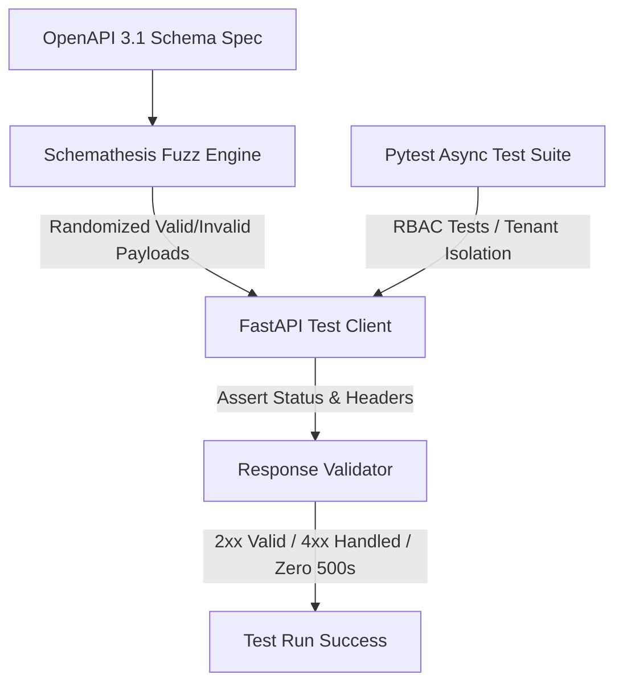

# WatchNet API Testing Specification

**Document Version:** 1.0.0  
**Status:** Approved Architecture Standard  
**Frameworks:** `pytest`, `httpx` (Async Client), `schemathesis` (OpenAPI Fuzzer), `pydantic`  
**Coverage Target:** 100% of exposed REST routes and WebSocket contracts  

---

## 1. Testing Scope & Methodology

The WatchNet API testing framework verifies the correctness, security, performance, and contract compliance of the FastAPI backend:
1. **Contract & Schema Fuzzing:** Automated property-based fuzz testing using `schemathesis` against the OpenAPI 3.1 specification to guarantee no unhandled 500 errors occur under arbitrary inputs.
2. **Authentication & RBAC Matrix:** Strict verification of endpoint security, verifying that missing, expired, or improperly scoped JWTs are rejected with `401 Unauthorized` or `403 Forbidden`.
3. **Multi-Tenant Isolation Validation:** Direct tests asserting that a valid token for Tenant A cannot read, mutate, or enumerate resources belonging to Tenant B.



---

## 2. Test Suite Organization & Structure

Tests are organized under `services/api/tests/` mirror-structured to the API router structure:

```
services/api/tests/
├── conftest.py                # Database fixtures, test client, mock seeds, token factories
├── api/
│   ├── v1/
│   │   ├── test_auth.py       # Login, refresh token, password reset, 2FA validation
│   │   ├── test_devices.py    # Device CRUD, IP history, lock fields, pagination
│   │   ├── test_discovery.py  # Ingest batch observations, signature validation, rate limits
│   │   ├── test_integrations.py # Router adapters, Pi-hole, AdGuard, HA credentials
│   │   ├── test_parental.py   # Profiles, DNS schedules, category rules, bypasses
│   │   └── test_topology.py   # Switch port links, AP Wi-Fi telemetry mappings
└── security/
    ├── test_rbac.py           # SUPER_ADMIN vs OPERATOR vs VIEWER permissions
    ├── test_tenant_rls.py     # Cross-tenant query boundary assertions
    └── test_ssrf_guards.py    # Localhost, metadata IP egress blocking tests
```

---

## 3. Reference Test Implementation (Pytest + AsyncClient)

```python
import pytest
from httpx import AsyncClient

@pytest.mark.asyncio
async def test_device_creation_and_lock_field(
    client: AsyncClient,
    admin_auth_headers: dict,
    sample_device_payload: dict
):
    # 1. Create Device
    response = await client.post(
        "/api/v1/devices",
        json=sample_device_payload,
        headers=admin_auth_headers
    )
    assert response.status_code == 201
    created_device = response.json()
    assert created_device["custom_name"] == sample_device_payload["custom_name"]
    device_id = created_device["id"]

    # 2. Lock Name Field
    lock_res = await client.patch(
        f"/api/v1/devices/{device_id}",
        json={"is_name_locked": True},
        headers=admin_auth_headers
    )
    assert lock_res.status_code == 200
    assert lock_res.json()["is_name_locked"] is True

    # 3. Simulate Ingest Overwrite Attempt
    sweep_ingest = {
        "observations": [{
            "mac_address": sample_device_payload["mac_address"],
            "ip_address": "192.168.1.99",
            "hostname": "new-rogue-hostname"
        }]
    }
    ingest_res = await client.post(
        "/api/v1/discovery/ingest",
        json=sweep_ingest,
        headers=admin_auth_headers
    )
    assert ingest_res.status_code == 202

    # 4. Verify Name Persisted Without Overwrite
    verify_res = await client.get(
        f"/api/v1/devices/{device_id}",
        headers=admin_auth_headers
    )
    assert verify_res.json()["custom_name"] == sample_device_payload["custom_name"]
    assert verify_res.json()["raw_dhcp_hostname"] == "new-rogue-hostname"
```

---

## 4. CI/CD Execution Command

```bash
# Run full suite with coverage and zero 500 error fuzzing
pytest services/api/tests/ \
  -v \
  --asyncio-mode=auto \
  --cov=src \
  --cov-report=term-missing \
  --cov-fail-under=85
```
