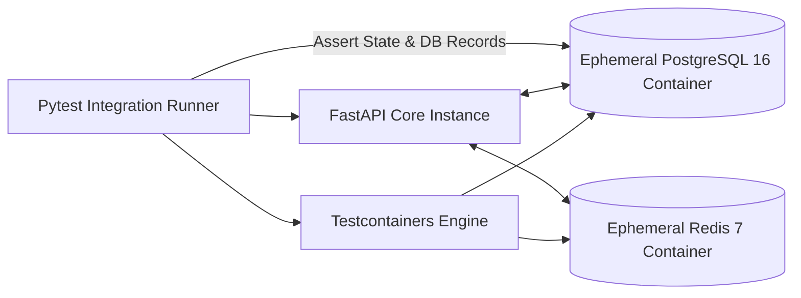

# WatchNet Integration Testing Specification

**Document Version:** 1.0.0  
**Status:** Approved Architecture Standard  
**Frameworks:** Testcontainers (PostgreSQL 16, Redis 7), `pytest-asyncio`, Docker  
**Scope:** Multi-Service Integration, Database Transactions, Redis Pub/Sub  

---

## 1. Architectural Scope & Objectives

Integration testing verifies that the decoupled components of the WatchNet architecture communicate reliably and maintain transactional integrity under realistic multi-service conditions:
1. **Database Schema & Migration Validation:** Executes real Alembic migrations from scratch on a live PostgreSQL 16 container, verifying column constraints, foreign keys, triggers, and Row-Level Security policies.
2. **Redis Message Queue & Cache Invalidation:** Tests that event publishers post messages to Redis streams, background consumers process them, and cache entries invalidate as expected.
3. **Collector-to-API Ingest Pipeline:** Feeds simulated raw network scan batches through the HTTP ingest endpoint and asserts proper persistence into PostgreSQL.



---

## 2. Test Environment & Testcontainers Fixtures

Integration tests do not rely on fragile external databases or SQLite emulation (which lacks PostgreSQL-specific RLS, JSONB operators, and network types). Instead, Testcontainers provisions real Dockerized engines on demand.

### 2.1 Pytest Fixture Example (`conftest.py`)
```python
import pytest
from testcontainers.postgres import PostgresContainer
from testcontainers.redis import RedisContainer
from sqlalchemy.ext.asyncio import create_async_engine, async_sessionmaker

@pytest.fixture(scope="session")
def postgres_container():
    with PostgresContainer("postgres:16-alpine") as postgres:
        yield postgres

@pytest.fixture(scope="session")
def redis_container():
    with RedisContainer("redis:7-alpine") as redis:
        yield redis

@pytest.fixture(scope="session")
async def db_engine(postgres_container):
    engine = create_async_engine(postgres_container.get_connection_url())
    # Apply Alembic migrations
    # ...
    yield engine
    await engine.dispose()
```

---

## 3. Integration Scenarios Tested

- **Session Continuity across IP Changes:** When a device MAC is seen with a new IP, verify that the active session updates cleanly and creates an entry in `device_ip_history` without duplicate MAC constraint errors.
- **Concurrent Ingestion Race Conditions:** 5 concurrent collector workers submit observations for the same subnet simultaneously. Verify zero deadlock exceptions and complete upsert consistency.
- **Redis Queue Failover & Offline Recovery:** Disconnect Redis briefly; verify the FastAPI backend buffers events or gracefully logs degraded state without crashing HTTP workers.

---

## 4. Execution Command

```bash
# Execute integration test suite with docker container isolation
pytest tests/integration/ -v --maxfail=1
```
