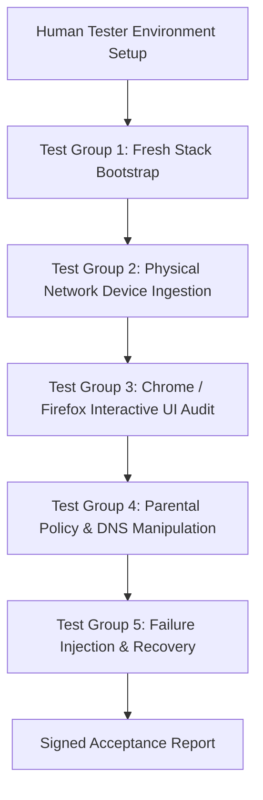

# WatchNet Manual Testing Plan

**Document Version:** 1.0.0  
**Status:** Approved Architecture Standard  
**Mandatory Phase:** Phase 11 Final Acceptance Protocol  
**Scope:** Real-World Hardware Verification, Browser Usability, Physical Network Events  

---

## 1. Testing Philosophy: The Reality Check

In accordance with Section 9 and Phase 11 of the Master Directive:
> *"This phase is mandatory. Do not finish the project just because automated tests pass. Perform actual browser-based and network-based testing."*

Automated unit and mock tests cannot fully replicate physical hardware quirks (e.g., Wi-Fi beacon jitter, power-saving sleep modes on mobile phones, router firmware differences, browser layout shifts under localized date formats). This manual testing plan outlines the human tester workflow required before declaring production readiness.

---

## 2. Structured Test Suites & Execution Steps

### Suite 1: Clean Deployment & Onboarding (Estimated: 20 mins)
1. **Action:** Clone repo on a clean machine and run `docker compose up -d`.
2. **Verification:** Inspect `docker compose logs -f`; assert zero repeating exceptions or database connection loops.
3. **Action:** Open Chrome to `http://localhost:3000`. Complete initial setup wizard by creating root Super-Admin account.
4. **Verification:** Confirm redirect to dashboard and welcome state with zero discovered devices.

### Suite 2: Physical Device Discovery & Live Tracking (Estimated: 45 mins)
1. **Action:** Connect mobile phone to local Wi-Fi. Toggle Airplane Mode on and off.
2. **Verification:**
   - WatchNet UI renders the phone's MAC and DHCP hostname within 60 seconds.
   - Device status displays green "Online" pill.
   - Heatmap slot increments online minute counter.
3. **Action:** Edit phone name to "Tester iPhone", assign icon "mobile", and toggle "Lock Name".
4. **Action:** Force a new network scan.
5. **Verification:** Assert "Tester iPhone" is preserved and not overwritten by subsequent scans.

### Suite 3: Interactive Diagnostics & UI Audit (Estimated: 30 mins)
1. **Action:** Navigate to `/diagnostics`.
2. **Action:** Enter gateway IP `192.168.1.1` and click "Run Ping".
3. **Verification:** Output terminal streams real ping times with zero UI freezing.
4. **Action:** Run "Port Scan" on common ports; verify discovered open services render in table.
5. **Action:** Test UI responsiveness: resize browser to mobile dimensions (375px wide); verify hamburger menu functions and tables scroll horizontally without breaking layout.

### Suite 4: Parental Controls & Schedule Boundary (Estimated: 30 mins)
1. **Action:** Create a profile "Kids", assign test tablet to profile.
2. **Action:** Configure bedtime lockout active starting 2 minutes in the future.
3. **Action:** Observe test tablet when clock reaches start time.
4. **Verification:** DNS queries to test domains (`youtube.com`, `tiktok.com`) resolve to block landing page or fail.
5. **Action:** Click "Grant 15-Minute Bypass" in admin UI. Verify tablet immediately regains access.

### Suite 5: Failure Injection & Resilience (Estimated: 30 mins)
1. **Action:** Kill PostgreSQL container (`docker compose stop db`).
2. **Verification:** Web UI shows clear, polite "Service Unavailable / Reconnecting" banner rather than raw unhandled React crashes.
3. **Action:** Restart database (`docker compose start db`).
4. **Verification:** UI automatically reconnects and resumes live SSE event stream within 10 seconds.
