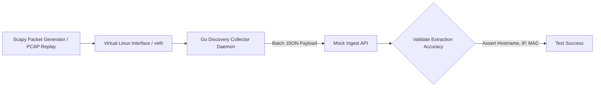

# WatchNet Network Discovery Testing Specification

**Document Version:** 1.0.0  
**Status:** Approved Architecture Standard  
**Test Tools:** Virtual Ethernet pairs (`veth`), Scapy, `pcap` replays, isolated Docker networks  
**Scope:** ARP Sweeps, mDNS Listeners, ICMP Echo, NetBIOS, Batch Collector Ingest  

---

## 1. Architectural Scope & Testing Environment

Network discovery operates at layers 2, 3, and 4. Testing must guarantee that the Go collector accurately identifies devices, parses vendor fingerprints, and handles edge cases without flooding the network:
1. **Isolated Virtual Network Sandbox:** Tests execute in dedicated Docker networks with predictable container IPs and synthetic virtual interfaces (`veth`), ensuring tests never interfere with host LAN environments.
2. **Packet Crafting & PCAP Injection:** Uses Scapy and recorded `pcap` captures to replay rare network anomalies (e.g., duplicate IP responses, garbled mDNS records, broadcast storms) to assert collector resilience.
3. **Buffer Eviction & Drain:** Verifies that when the API backend is unreachable, the collector queues observations in memory and drains them in chronological order once connectivity recovers.



---

## 2. Test Cases & Verification Procedures

### 2.1 Passive mDNS & NetBIOS Fingerprint Extraction
- Inject synthetic mDNS multicast packets advertising `_airplay._tcp.local` and `_googlecast._tcp.local`.
- Assert the collector extracts device model names (`Apple TV 4K`, `Chromecast`) and tags them with high confidence.

### 2.2 IP Collision & Roaming Test
- Simulate a MAC address hopping from `192.168.1.50` to `192.168.1.75` within 10 seconds.
- Assert collector emits two observation events in correct chronological sequence with accurate timestamps.

### 2.3 Collector Offline Queue Drain Test
```bash
# Automated bash test executing collector queue drain
# 1. Start Collector with API container stopped
docker compose stop api
# 2. Generate 100 network events via Scapy generator
python tests/discovery/generate_traffic.py --count 100
# 3. Verify collector buffer count == 100, drops == 0
# 4. Start API container
docker compose start api
# 5. Wait 5s, verify collector buffer count == 0 and API DB contains all 100 records
```

---

## 3. Automated Test Command

```bash
# Run discovery engine integration tests inside isolated container
go test -v -race -tags=integration ./collector/...
```
