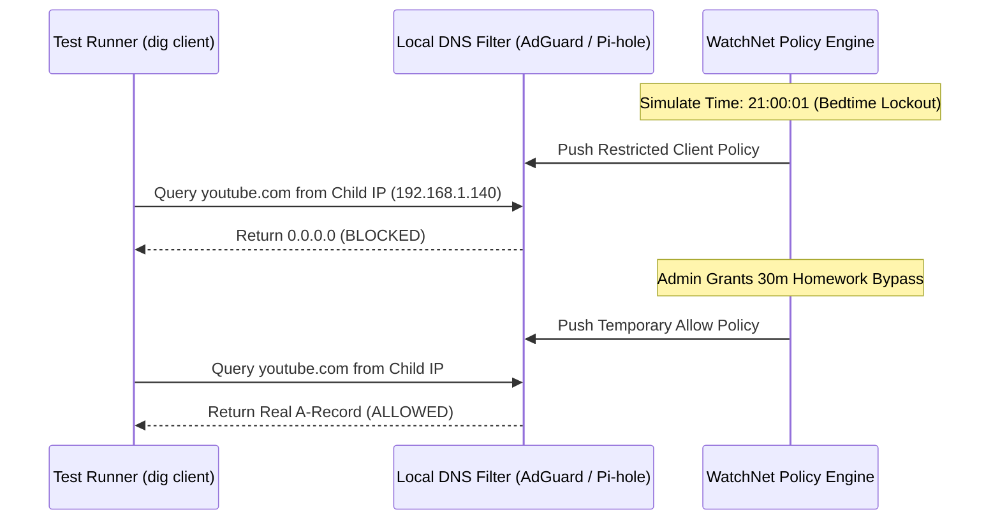

# WatchNet Parental Control Testing Specification

**Document Version:** 1.0.0  
**Status:** Approved Architecture Standard  
**Test Tools:** DNS query clients (`dig`, `dnspython`), Schedule Simulators, Mock AdGuard/Pi-hole API  
**Scope:** Time-of-Day Bedtime Schedules, Category Blocking, Temporary Bypasses, SafeSearch  

---

## 1. Architectural Scope & Testing Boundaries

Parental control testing validates the deterministic execution of family safety policies across DNS and router enforcement mechanisms:
1. **Schedule Boundary Precision:** Tests that time-of-day policies (e.g., Bedtime lockout active from 21:00 to 07:00) switch states within 10 seconds of the scheduled boundary across all timezones.
2. **Category Enforcement Invariance:** Asserts that domains belonging to blocked categories (e.g., Adult, Gambling, Social Media) resolve to `0.0.0.0` or custom block landing pages when tested from a restricted client IP.
3. **Emergency Bypass Mechanics:** Verifies that administrative temporary bypasses (e.g., 30-minute homework extension) cleanly restore DNS resolution and automatically re-lock at expiration.



---

## 2. Deterministic Schedule Simulation Test

```python
import pytest
from datetime import datetime, time
from zoneinfo import ZoneInfo
from src.services.parental_policy import evaluate_schedule_state

def test_bedtime_schedule_boundary():
    # Schedule: Bedtime every weekday from 21:00 to 07:00 next morning
    schedule = {
        "days": ["monday", "tuesday", "wednesday", "thursday", "friday"],
        "start_time": time(21, 0),
        "end_time": time(7, 0),
        "timezone": "America/New_York"
    }

    tz = ZoneInfo("America/New_York")
    
    # 20:59:59 Monday -> ALLOWED
    t1 = datetime(2026, 11, 16, 20, 59, 59, tzinfo=tz)
    assert evaluate_schedule_state(schedule, t1) is False

    # 21:00:01 Monday -> BLOCKED
    t2 = datetime(2026, 11, 16, 21, 0, 1, tzinfo=tz)
    assert evaluate_schedule_state(schedule, t2) is True

    # 06:59:59 Tuesday -> BLOCKED
    t3 = datetime(2026, 11, 17, 6, 59, 59, tzinfo=tz)
    assert evaluate_schedule_state(schedule, t3) is True

    # 07:00:01 Tuesday -> ALLOWED
    t4 = datetime(2026, 11, 17, 7, 0, 1, tzinfo=tz)
    assert evaluate_schedule_state(schedule, t4) is False
```

---

## 3. End-to-End DNS Verification Command

```bash
# Execute DNS resolution tests across configured parental control profiles
python tests/parental/verify_dns_filtering.py --target-dns 127.0.0.1 --profile-ip 192.168.1.140
```
