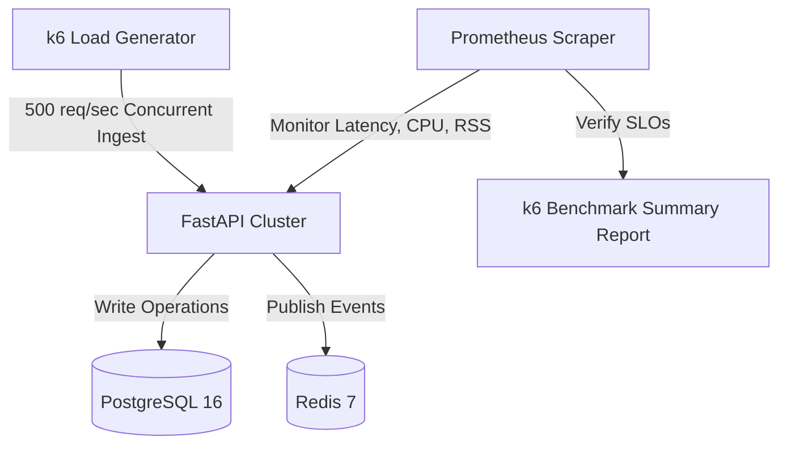

# WatchNet Performance Testing Specification

**Document Version:** 1.0.0  
**Status:** Approved Architecture Standard  
**Tools:** k6, Locust, PostgreSQL `pg_stat_statements`, Prometheus / Grafana  
**Targets:** High-Density Subnets (/16, /24), High-Frequency Ingest, Low-Footprint UI  

---

## 1. Architectural Scope & Performance Benchmarks

WatchNet must run comfortably on resource-constrained hardware (e.g., Raspberry Pi 4 / 5, home NAS, budget mini-PCs) while remaining capable of scaling to multi-site enterprise environments with thousands of devices.

### Hard Performance Service Level Objectives (SLOs):
| Metric / Endpoint | Target Benchmark | Maximum Threshold | Test Conditions |
|---|---|---|---|
| **API Ingestion Throughput** | 500 obs/sec | 100 obs/sec | Batch sweeps from 10 collectors |
| **Device Table API Latency** | < 45 ms (p95) | 120 ms (p99) | 1,000 devices, pagination=50 |
| **WebSocket / SSE Broadcast** | < 100 ms | 250 ms | 50 concurrent connected browsers |
| **Go Collector CPU Usage** | < 3% single core | < 8% peak | Continuous 30s ARP sweep cycle |
| **Memory Footprint (Collector)**| < 35 MB RSS | < 60 MB RSS | 24-hour soak run |
| **Memory Footprint (API Stack)**| < 250 MB RSS | < 500 MB RSS | Production FastAPI + Uvicorn |



---

## 2. Load Testing Scenarios & k6 Script

The primary stress vector is high-volume discovery ingestion:

```javascript
import http from 'k6/http';
import { check, sleep } from 'k6';

export const options = {
  stages: [
    { duration: '30s', target: 20 },  // Ramp-up to 20 virtual collectors
    { duration: '2m', target: 50 },   // Sustained load
    { duration: '30s', target: 0 },   // Ramp-down
  ],
  thresholds: {
    http_req_duration: ['p(95)<150'], // 95% of requests must complete below 150ms
    http_req_failed: ['rate<0.01'],   // Error rate must be under 1%
  },
};

export default function () {
  const payload = JSON.stringify({
    collector_id: 'col_stress_01',
    site_id: 'site_perf_test',
    observations: [
      { mac: '00:11:22:33:44:01', ip: '10.0.0.10', hostname: 'host-1' },
      { mac: '00:11:22:33:44:02', ip: '10.0.0.11', hostname: 'host-2' },
      { mac: '00:11:22:33:44:03', ip: '10.0.0.12', hostname: 'host-3' }
    ]
  });

  const params = {
    headers: {
      'Content-Type': 'application/json',
      'Authorization': 'Bearer perf-test-token'
    },
  };

  const res = http.post('http://localhost:8000/api/v1/discovery/ingest', payload, params);
  check(res, { 'status is 202': (r) => r.status === 202 });
  sleep(0.5);
}
```

---

## 3. Database Query Optimization & Index Auditing

- Run `EXPLAIN (ANALYZE, BUFFERS)` over critical queries (`SELECT * FROM devices WHERE tenant_id = ... ORDER BY last_seen DESC LIMIT 50`).
- Ensure no sequential scans (`Seq Scan`) occur on device or session tables exceeding 5,000 rows.
