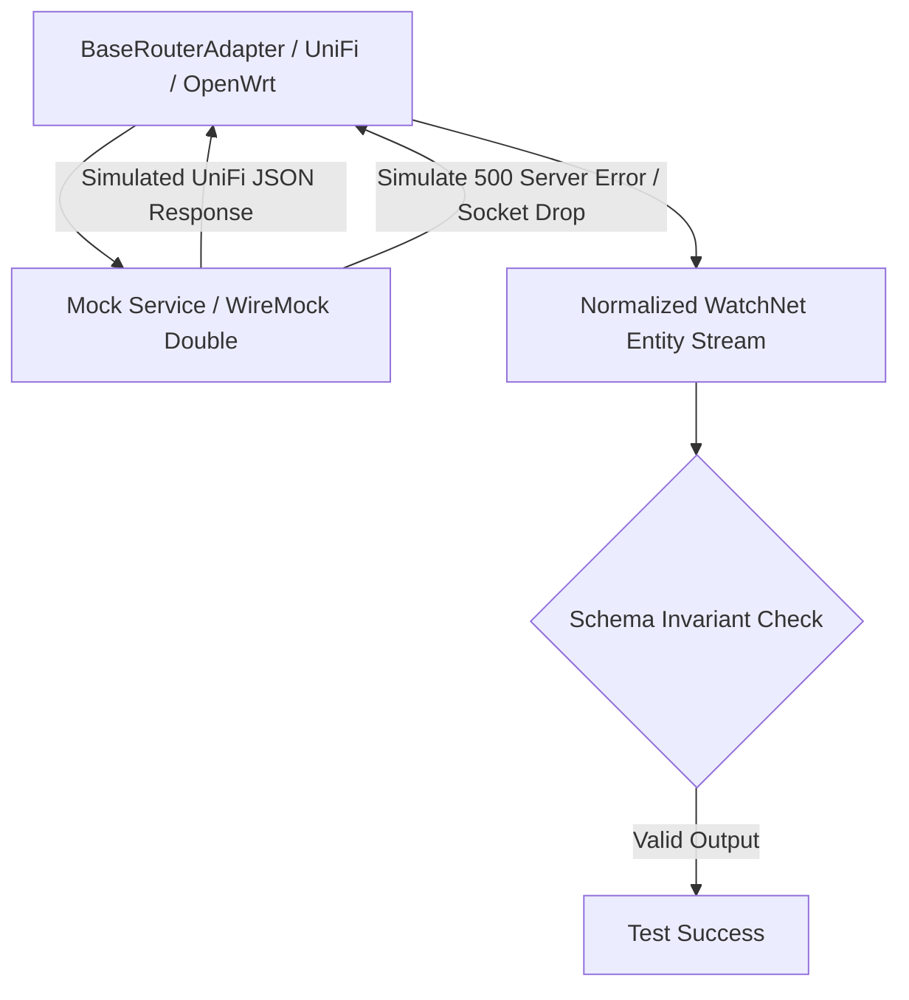

# WatchNet Router Testing Specification

**Document Version:** 1.0.0  
**Status:** Approved Architecture Standard  
**Frameworks:** Mock HTTP Servers (`respx`, `wiremock`), Fake SSH Daemons, Synthetic SNMP Agents  
**Scope:** `BaseRouterAdapter` Implementations, Error Recovery, Credential Safety  

---

## 1. Architectural Scope & Test Double Strategy

Testing router integrations against physical production hardware during continuous integration (CI) is impractical and hazardous. WatchNet uses a tiered testing strategy combining realistic software test doubles with periodic automated hardware lab sweeps:
1. **Mock Double Verification (CI Default):** Simulates router HTTP/SSH/SNMP endpoints with verified realistic payloads from UniFi, OpenWrt, MikroTik, and Omada.
2. **Contract & Schema Invariance:** Verifies that regardless of vendor quirk (e.g., lowercase MAC addresses in UniFi vs hyphen-delimited uppercase in MikroTik), all adapters output normalized WatchNet entity records.
3. **Resilience & Timeout Handling:** Asserts that dropped connections, bad credentials, or slow router responses fail gracefully without hanging the discovery pipeline.



---

## 2. Test Scenarios & Invariant Assertions

### 2.1 MAC and IP Normalization Contract
```python
import pytest
from src.integrations.adapters.unifi import UniFiAdapter
from src.integrations.adapters.mikrotik import MikroTikAdapter

@pytest.mark.asyncio
async def test_mac_normalization_invariant(mock_unifi_server, mock_mikrotik_server):
    unifi_adapter = UniFiAdapter(base_url=mock_unifi_server.url, credentials={...})
    unifi_devices = await unifi_adapter.fetch_connected_clients()
    
    mikrotik_adapter = MikroTikAdapter(base_url=mock_mikrotik_server.url, credentials={...})
    mikrotik_devices = await mikrotik_adapter.fetch_connected_clients()

    for dev in unifi_devices + mikrotik_devices:
        # Assert canonical lowercase colon format: aa:bb:cc:dd:ee:ff
        assert len(dev.mac_address) == 17
        assert dev.mac_address == dev.mac_address.lower()
        assert dev.mac_address.count(":") == 5
```

### 2.2 Graceful Degradation on Bad Credentials
- Inject HTTP `401 Unauthorized` into the adapter client.
- Assert that the adapter raises `IntegrationAuthenticationError`, marks the instance status as `CREDENTIALS_INVALID` in the database, and leaves existing discovered devices intact.

---

## 3. Hardware Test Lab Execution

For physical testing against real lab routers:
```bash
# Execute against lab router environment variables
ROUTER_LAB_ENABLED=true pytest tests/routers/test_live_hardware.py -v
```
