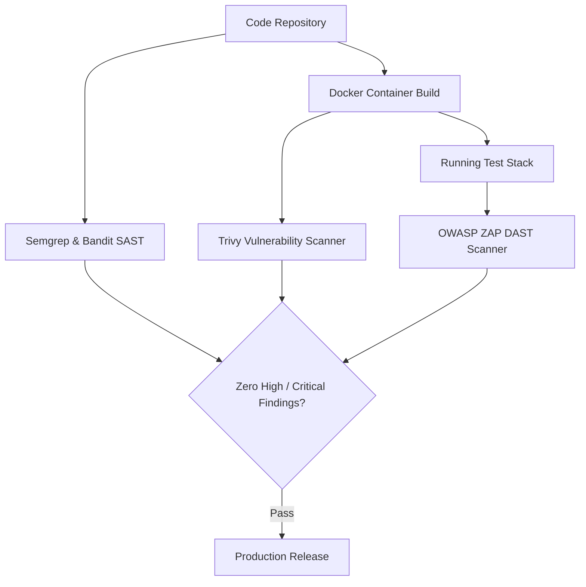

# WatchNet Security Testing Specification

**Document Version:** 1.0.0  
**Status:** Approved Architecture Standard  
**Frameworks:** OWASP ZAP, Bandit, Semgrep, Trivy, sqlmap  
**Applicability:** Dynamic Analysis (DAST), Static Analysis (SAST), Container Scans  

---

## 1. Architectural Scope & Security Verification

WatchNet handles raw network interfaces, router administrative credentials, and parental safety metadata. Security testing is an automated, mandatory quality gate:
1. **Static Analysis Security Testing (SAST):** Semgrep and Bandit audit Python backend and Go collector source code for insecure crypto, hardcoded secrets, shell injection, or unsafe deserialization.
2. **Dynamic Application Security Testing (DAST):** Automated OWASP ZAP and Schemathesis runs test for SQL injection, Cross-Site Scripting (XSS), Server-Side Request Forgery (SSRF), and broken access control.
3. **Container & Dependency Scanning:** Trivy inspects all base Docker images and third-party libraries for known CVEs.



---

## 2. Automated Security Test Procedures

### 2.1 Anti-SSRF Defense Verification
Tests intentionally supply internal metadata and loopback IP addresses to external integration and webhook endpoints to assert defensive rejection:
- `http://169.254.169.254/latest/meta-data/` -> Must return `400 Bad Request` ("Prohibited IP range").
- `http://127.0.0.1:8000/internal/admin` -> Must return `400 Bad Request`.
- Target domains resolving via DNS rebinding to loopback ranges must be detected and blocked.

### 2.2 Broken Object Level Authorization (BOLA / IDOR) Test
- User with `VIEWER` role in Tenant A requests `GET /api/v1/devices/{device_id_in_tenant_b}`.
- Test asserts that the response is `404 Not Found` (preferred to avoid leaking ID existence) or `403 Forbidden`, with zero data leakage.

### 2.3 SQL Injection Resistance
- Fuzz query parameters (`/api/v1/devices?search=' OR 1=1 --`) using SQLAlchemy parameterized queries. Assert that results treat input strictly as a literal search string.

---

## 3. Execution Commands & Quality Gates

```bash
# 1. Static code analysis
semgrep --config=p/security-audit services/api/
bandit -r services/api/src/ -ll

# 2. Container vulnerability scan
trivy image --severity HIGH,CRITICAL ghcr.io/watchnet/watchnet-api:latest

# 3. Dynamic API security fuzzing
schemathesis run http://localhost:8000/openapi.json --checks all --rate-limit=50/s
```
- **Quality Gate:** Zero unresolved `HIGH` or `CRITICAL` severity CVEs or SAST vulnerabilities are permitted for merge.
