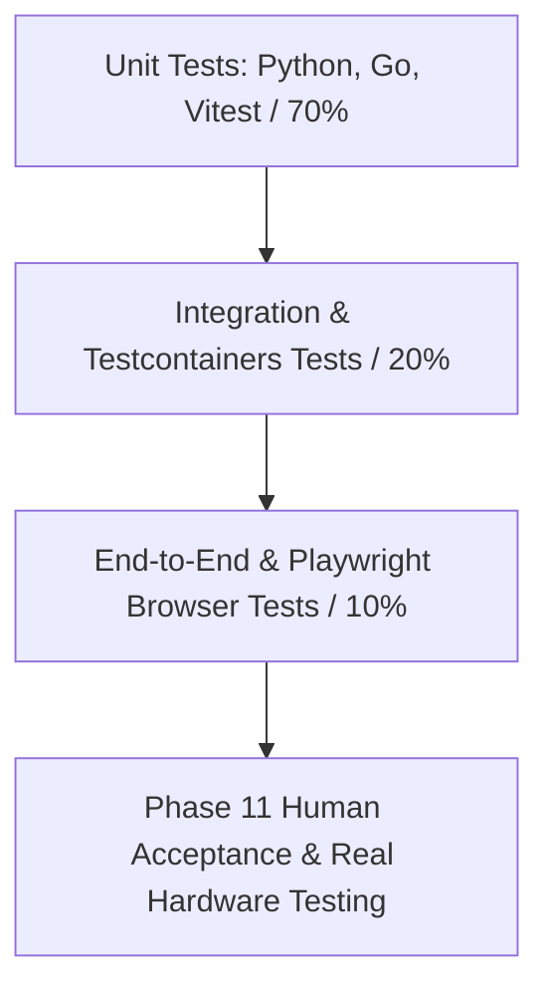

# WatchNet Testing Strategy Specification

**Document Version:** 1.0.0  
**Status:** Approved Architecture Standard  
**Testing Pyramid:** Unit Tests (70%) -> Integration Tests (20%) -> E2E & Manual Tests (10%)  

---

## 1. Architectural Scope & Quality Philosophy

The WatchNet testing strategy enforces rigorous software verification across all development phases:
1. **Multi-Layered Verification Pyramid:** High-speed unit tests validate domain algorithms in milliseconds; integration tests validate containerized database transactions; end-to-end tests validate browser workflows in Playwright; and manual testing validates physical hardware reality.
2. **Quality Gates & Zero-Regression Policy:** No pull request is merged without passing unit tests, contract schemas, and linting checks.
3. **Hardware Double Testing:** Hardware and network dependencies (routers, switches, DNS servers) use validated mock doubles during continuous integration.



---

## 2. Test Execution Tiers & Quality Gates

| Tier | Focus Area | Frameworks | Execution Trigger | Gate Criteria |
|---|---|---|---|---|
| **Tier 1: Unit** | Algorithmic logic, parsers, crypto, math | `pytest`, `go test`, `vitest` | Every commit / PR | 100% pass, >85% coverage |
| **Tier 2: Integration**| DB migrations, RLS policies, Redis, ingest | Testcontainers, PostgreSQL 16 | Pre-merge CI | Zero transaction errors |
| **Tier 3: Security & API**| OpenAPI schemas, anti-SSRF, auth matrix | `schemathesis`, `semgrep`, `bandit` | Pre-merge CI | Zero 500 errors, zero High/Crit CVEs |
| **Tier 4: E2E Browser**| UI user flows, SSE live updates, responsiveness| Playwright | Nightly & Release PRs | All critical user journeys pass |
| **Tier 5: Human Acceptance**| Physical Wi-Fi events, real lab routers | Real Devices, Chrome | Phase 11 Sign-off | Signed acceptance checklist |

---

## 3. Continuous Integration Pipeline Workflow

```yaml
# .github/workflows/test.yml summary
name: WatchNet Test Pipeline
on: [push, pull_request]

jobs:
  lint-and-typecheck:
    runs-on: ubuntu-latest
    steps:
      - uses: actions/checkout@v4
      - run: ruff check services/api
      - run: pnpm --filter @watchnet/web lint
      - run: pnpm --filter @watchnet/web typecheck

  unit-tests:
    runs-on: ubuntu-latest
    steps:
      - uses: actions/checkout@v4
      - run: pytest services/api/tests/unit -v
      - run: go test -v -race ./collector/...
      - run: pnpm --filter @watchnet/web test:unit

  integration-tests:
    runs-on: ubuntu-latest
    steps:
      - uses: actions/checkout@v4
      - run: pytest services/api/tests/integration -v
```
