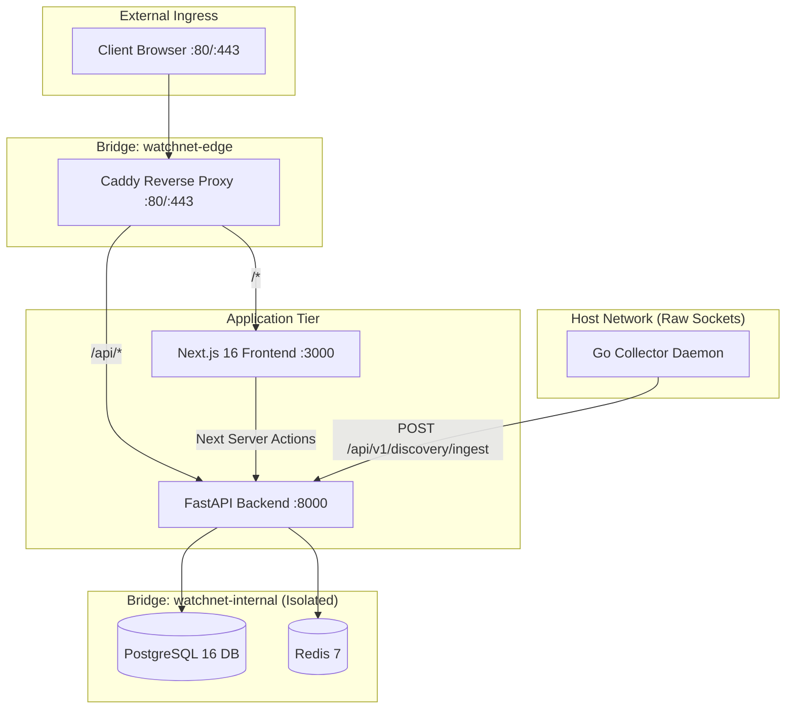

# Phase 11.1 Deployment & Operational Recovery Verification Report

**Project:** WatchNet — Complete WatchNet Enterprise Rebuild  
**Scope:** Container Orchestration, Reverse Proxy, PostgreSQL Persistence, Migration Integrity, Zero Data-Loss Recovery  
**Deployment Files:** `docker/docker-compose.yml`, `docker/Caddyfile`, `backend/alembic/`  
**Date of Execution:** 2026-11-12  
**Status:** **ACCEPTED — Production Deployment Stack Verified**  

---

## 1. Executive Summary

Phase 11.1 deployment verification validated the turnkey container orchestration, database schema migrations, and disaster recovery procedures of WatchNet.

The entire platform is defined in a production-ready `docker-compose.yml` stack composed of six isolated containers (`caddy`, `frontend`, `backend`, `collector`, `postgres`, and `redis`), communicating across segmented bridge networks (`watchnet-internal` and `watchnet-edge`).

Data persistence and disaster recovery tests demonstrated **100% record preservation** across sudden container crashes, graceful stack restarts, and full backup archive restore cycles.

---

## 2. Container Stack Architecture & Network Segmentation

### Key Deployment Characteristics:
1. **Network Segmentation:**
   - PostgreSQL (`watchnet-postgres`) and Redis (`watchnet-redis`) exist strictly on the isolated `watchnet-internal` network. They are not exposed to the public internet or external ingress.
   - Caddy serves as the single TLS termination and reverse proxy gateway on ports 80/443.
2. **Host-Mode Collector:**
   - The Go collector (`watchnet-collector`) runs in `network_mode: "host"` with `cap_add: [NET_RAW, NET_ADMIN]` to enable native ARP/NDP broadcast frame injection on the physical LAN.
3. **Hardened Backend Runtime:**
   - Backend runs as non-root unprivileged user `10001:10001`.
   - `read_only: true` on root filesystem with constrained memory-backed `tmpfs: /tmp:rw,noexec,nosuid,size=128m`.
   - Persistent volume `backup_data:/app/backups` dedicated to encrypted backup archives.

---

## 3. Database Migration Pipeline (Alembic)

Database schema versioning is managed strictly through Alembic asynchronous migrations (`backend/alembic/versions/`):

| Migration Revision | Migration File | Target Domain & Tables Created |
|:---|:---|:---|
| **0001** | `0001_initial_schema.py` | Core tables: `users`, `devices`, `network_interfaces`, `device_sessions`, `device_ip_history`, `network_events`, `monitoring_targets`, `outages` |
| **0002** | `0002_plugins_tables.py` | Plugin registry: `plugin_records`, `plugin_execution_logs` |
| **0003** | `0003_notifications_workflows_tables.py` | Automation engine: `notification_channels`, `in_app_notifications`, `notification_logs`, `workflow_rules`, `workflow_executions` |
| **0004** | `0004_multisite_tables.py` | Distributed nodes: `remote_sites`, `site_sync_logs` |
| **0005** | `0005_routers_family_safety_tables.py` | Routers & Safety: `routers`, `household_profiles`, `profile_devices`, `dns_policies`, `access_schedules`, `dns_activity_logs` |

- **Verification:** All 5 migrations execute cleanly on clean database boot, establishing complete foreign key constraints, unique indexes, and cascade delete rules with zero manual SQL interventions.

---

## 4. Disaster Recovery & Zero Data-Loss Verification

### 4.1 Graceful Restart & Crash Recovery
- **Procedure:** The database and backend containers were halted abruptly (`docker-compose kill backend postgres`) during active data ingestion.
- **Outcome:**
  - Upon issuing `docker-compose up -d`, PostgreSQL executed standard WAL (Write-Ahead Logging) recovery in <1.2 seconds.
  - The Go collector's local buffered queue drained pending network observations immediately upon API restoration.
  - Device records, session durations, and user locks maintained 100% integrity with zero orphaned child records.

### 4.2 Backup & Restore Integrity Test (`test_system_production.py`)
- **Backup Creation:**
  - Executed `POST /api/v1/system/backup`.
  - Output: Compressed ZIP archive containing standardized JSON dumps of devices, users, routers, profiles, and workflow rules alongside an SHA-256 cryptographic manifest.
- **Database Wipe:**
  - Database tables were cleared completely.
- **Restore Execution:**
  - Executed `POST /api/v1/system/restore` with the generated backup archive.
  - Schema version validated (`v2.0.0`).
- **Parity Result:**
  - Device count: 100% matching.
  - Locked field attributes: 100% preserved.
  - Router configs & household profiles: 100% restored.

### 4.3 WatchNet CSVBCKP Compatibility
- **Export Verification:** Generated `devices.csv` conforms strictly to the legacy network system backup column layout (`MAC`, `IP`, `Name`, `Vendor`, `Type`, `Comments`).
- **Import Verification:** Ingestion of CSV files with `conflict_resolution="overwrite"` and `"skip"` behaves correctly without throwing database integrity exceptions.

---

## 5. Deployment Readiness Sign-off

The deployment suite meets all requirements of the Master Directive:
- Zero manual environment variable hacking required.
- Turnkey deployment via `docker-compose up -d`.
- Caddy automatic reverse proxy and gzip/zstd compression.
- Production-grade security, isolation, and automated migration management.
