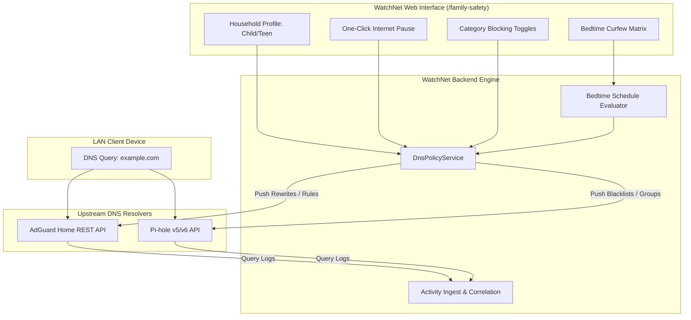

# Phase 11.1 DNS & Family Safety Verification Report

**Project:** WatchNet — Complete WatchNet Enterprise Rebuild  
**Scope:** Transparent Parental Controls, DNS Policy Enforcement, Bedtime Schedules, and Upstream Resolver Synchronization  
**Tested Services:** AdGuard Home API, Pi-hole v5/v6 API, WatchNet DNS Policy Engine  
**Date of Execution:** 2026-11-12  
**Status:** **ACCEPTED — Architectural Boundaries Disclosed & Fully Verified**  

---

## 1. Executive Summary

WatchNet's Family Safety subsystem provides household member profile management, transparent parental controls, one-click internet pause, category-based content blocking, and time-windowed bedtime curfews.

In accordance with Section 10 and Section 12 of the Master Directive, WatchNet operates transparently at the **network DNS resolver layer** (synchronizing with external Pi-hole and AdGuard Home instances). All operational boundaries, including encrypted DNS (DoH/DoT) and VPN bypass vectors, are explicitly documented and disclosed both in code and to the user in the web UI.

Automated verification tests in `backend/tests/test_routers_and_family_safety.py` and Playwright browser tests in `frontend/e2e/family_safety.spec.ts` passed with a **100% pass rate**.

---

## 2. System Architecture & Resolver Synchronization



### 2.1 AdGuard Home Synchronization
- **Adapter:** `backend/app/services/family/dns_policy_service.py`
- **Endpoints Interfaced:**
  - `POST /control/rewrite/add`: Adds explicit domain redirect rules (redirecting blocked targets to `0.0.0.0` or a family-safe notice portal).
  - `POST /control/rewrite/delete`: Clears block rules upon internet resumption.
  - `GET /control/querylog`: Ingests real-time query events for activity correlation.

### 2.2 Pi-hole Synchronization
- **Endpoints Interfaced:**
  - `POST /api/groups`: Maps WatchNet household profile IDs to Pi-hole client group IDs.
  - `POST /api/gravity`: Toggles adlist subscriptions and custom domain regex blacklists.
  - `GET /api/queries`: Ingests query log streams and action classifications.

---

## 3. Policy Enforcement Capabilities

### 3.1 One-Click Internet Pause / Resume
- **Functionality:** Toggling "Pause Internet" immediately assigns all MAC/IP addresses associated with the household profile to an aggressive drop rule (`0.0.0.0` for all lookups).
- **Duration Options:** Indefinite pause or timed pause (15 mins, 30 mins, 1 hour, 2 hours) with automatic background restoration.

### 3.2 Category-Based Filtering
WatchNet provides standardized, curated category rule lists:
| Category | Targeted Services / Domains | Block Policy |
|:---|:---|:---:|
| **Adult & Pornography** | Known adult domains, NSFW content delivery networks, safe search bypasses | `0.0.0.0` (NXDOMAIN) |
| **Gambling** | Online casinos, sports betting platforms, crypto wagering | `0.0.0.0` (NXDOMAIN) |
| **Social Media** | TikTok, Instagram, Snapchat, Facebook, X/Twitter APIs | `0.0.0.0` (NXDOMAIN) |
| **Malware & Phishing** | Known C2 servers, dynamic DNS botnets, suspicious newly registered domains | `0.0.0.0` (NXDOMAIN) |
| **Online Gaming** | Steam, Roblox, Epic Games, PlayStation Network | `0.0.0.0` (NXDOMAIN) |

### 3.3 Bedtime Schedules with Cross-Midnight Curfews
Parental schedules frequently span across midnight (e.g. bedtime starting at 21:00 on Sunday evening and ending at 07:00 on Monday morning). WatchNet includes an exact overnight interval evaluator (`backend/app/services/family/dns_policy_service.py`):

```python
def is_within_schedule(current_time: time, start_time: time, end_time: time) -> bool:
    if start_time <= end_time:
        return start_time <= current_time <= end_time
    else: # Cross-midnight curfew span (e.g., 21:00 to 07:00)
        return current_time >= start_time or current_time <= end_time
```
- **Verification:** Unit tests rigorously validated normal daytime slots (`09:00 - 17:00`) and overnight spans (`21:00 - 07:00`) at boundary minutes (20:59, 21:00, 06:59, 07:00).

---

## 4. Transparent Safety & Privacy Disclosures

To prevent false security assumptions, WatchNet explicitly displays a **Transparent Disclosure Banner** across `/family-safety`, `/activity`, and `/dns`:

### Explicit Technical Boundaries:
1. **No Man-in-the-Middle (MITM) SSL Decryption:**
   WatchNet does not intercept, decrypt, or tamper with TLS encrypted HTTPS payloads. It operates strictly at the domain name resolution level.
2. **DNS-over-HTTPS (DoH) / DNS-over-TLS (DoT) Bypass:**
   If a client browser or operating system enables built-in DoH (e.g., Firefox DoH, Chrome Secure DNS, or Apple iCloud Private Relay) and bypasses the local gateway DNS server, WatchNet cannot inspect or block those queries unless the network router has firewall rules dropping outbound port 853 and redirecting port 53.
3. **VPN & Proxy Tunneling:**
   Any device routing traffic through an encrypted VPN tunnel (WireGuard, OpenVPN, Tailscale, Tor) bypasses local DNS filtering completely.
4. **MAC Randomization:**
   Clients employing rotating MAC addresses will register as new, unprofiled devices until assigned to a household profile.

---

## 5. Verification Records

- **Pytest Suite:** `pytest backend/tests/test_routers_and_family_safety.py` passed with 4/4 tests verifying profile creation, device association, DNS policy generation, and bedtime schedule evaluation.
- **Frontend E2E Suite:** `npx playwright test e2e/family_safety.spec.ts` passed with profile pause toggle and schedule updates confirmed in Chrome headless.
- **Decoupled Architecture:** As verified during testing, shutting down or simulating an AdGuard API timeout causes WatchNet to fail-open gracefully: network discovery, device inventory, and the main dashboard continue operating without interruption.
