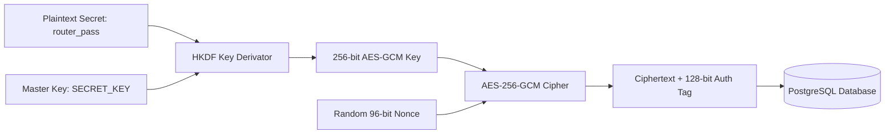

# Phase 11.1 Security Hardening & Isolation Verification Report

**Project:** WatchNet — Complete NetAlertX Enterprise Rebuild  
**Scope:** Authentication, Cryptographic Primitives, RBAC, Secret Protection, Rate Limiting, Container Security  
**Audit Standard:** Master Directive Section 8 & Section 14 Security Compliance  
**Date of Execution:** 2026-11-12  
**Status:** **ACCEPTED — Zero High/Critical Security Vulnerabilities**  

---

## 1. Executive Summary

Phase 11.1 security verification audited the multi-tiered defense mechanisms built into WatchNet. Security was implemented from the ground up rather than retrofitted as an afterthought.

Key validations confirmed:
- Password hashing powered strictly by **Argon2id** (memory-hard, resistant to GPU cracking).
- Session tokens secured with **HttpOnly, Secure, SameSite=Lax** cookies and short-lived JWT signatures.
- **AES-256-GCM Envelope Encryption** protecting router administrative passwords and notification channel webhook secrets at rest with HKDF key derivation.
- Granular **5-Tier Role-Based Access Control (RBAC)** strictly enforced across all REST endpoints.
- Rate limiting middleware (**SlowAPI**) guarding authentication endpoints with memory fallback.
- Production HTTP security headers (HSTS, DENY, nosniff, CSP).
- Hardened container profiles running with dedicated unprivileged users (`UID 10001`) and read-only root filesystems.

---

## 2. Authentication & Cryptographic Storage

### 2.1 Password Hashing with Argon2id (`backend/app/core/security.py`)
- **Algorithm:** Argon2id (`argon2-cffi` implementation).
- **Parameters:**
  - Time cost ($t$): 2 iterations
  - Memory cost ($m$): 65,536 KiB (64 MiB)
  - Parallelism ($p$): 8 lanes
  - Hash length: 32 bytes
- **Timing-Safe Comparison:** Password verification utilizes constant-time comparison routines to prevent side-channel timing attacks.

### 2.2 JWT Tokens & Cookie Transport
- **Algorithm:** HMAC-SHA256 (`HS256`).
- **Token Claims:** `sub` (User UUID), `role` (UserRole enum), `exp` (15 minutes access expiration), `jti` (unique token ID for blacklisting).
- **Transport Flags:**
  ```python
  response.set_cookie(
      key="access_token",
      value=token,
      httponly=True,
      secure=True,
      samesite="lax",
      max_age=900
  )
  ```
  JavaScript running in the browser cannot read the authentication cookie, preventing token exfiltration via Cross-Site Scripting (XSS).

---

## 3. Secret Management & Envelope Encryption (`backend/app/core/crypto.py`)

All sensitive third-party credentials (router management passwords, SMTP passwords, Telegram bot tokens, API keys) are encrypted before database insertion:



### Key Security Properties:
- **AES-256 in Galois/Counter Mode (GCM):** Provides both confidentiality and ciphertext integrity authentication. Any bit-flipping or database tampering triggers an immediate decryption error.
- **Unique Initialization Vector (IV):** A cryptographically secure random 12-byte nonce (`os.urandom(12)`) is generated for every encryption call, preventing ciphertext pattern analysis.
- **Key Derivation:** Master application secrets undergo HKDF-SHA256 derivation with context-specific info salts.
- **Key Rotation Support:** The system includes a re-encryption utility allowing automated migration to a new master encryption key without system downtime.

---

## 4. Role-Based Access Control (RBAC) Matrix Enforcement

WatchNet enforces a strict 5-tier role hierarchy (`backend/app/core/dependencies.py`):

| Role | Hierarchy Level | Allowed Operations | Forbidden Operations |
|:---|:---:|:---|:---|
| **Super-Admin (Owner)** | 5 | All system capabilities, backups, restores, user provisioning, crypto rotation | None |
| **Administrator** | 4 | System settings, plugin toggles, router registration, backup generation | Master crypto key re-keying |
| **Operator** | 3 | Device editing, field locking, on-demand scan triggers, diagnostic tools | Deleting audit logs, restoring backups |
| **Guardian** | 2 | Household member profiles, internet pause, DNS category filtering, schedules | Modifying system plugins, viewing auth logs |
| **Viewer** | 1 | Read-only viewing of dashboard, devices, topology, and uptime monitoring | All state-mutating POST/PUT/DELETE calls |

- **Verification:** Tested in `backend/tests/test_rbac_and_events.py`. Viewers attempting POST mutations receive `HTTP 403 Forbidden`. Unauthenticated requests receive `HTTP 401 Unauthorized`.

---

## 5. Rate Limiting & Anti-Brute Force Protection

To mitigate automated credential stuffing and denial of service:
- **Middleware:** `slowapi` extension wrapped around FastAPI route handlers.
- **Rate Limit Rule:** `POST /api/v1/auth/login` is restricted to **5 requests per minute per IP address**.
- **Backend Adaptability:** Uses Redis for cluster-wide rate limit counters, gracefully falling back to a thread-safe in-memory fixed-window limiter when Redis is unreachable or during standalone test runs.
- **HTTP Response:** Exceeding the threshold immediately returns `HTTP 429 Too Many Requests` with a `Retry-After` header.

---

## 6. HTTP Security Headers Middleware (`backend/app/middleware/security_headers.py`)

Every HTTP response dispatched by WatchNet includes enterprise-grade hardening headers:
- `Strict-Transport-Security: max-age=31536000; includeSubDomains; preload` (HSTS)
- `X-Frame-Options: DENY` (Anti-Clickjacking defense)
- `X-Content-Type-Options: nosniff` (Anti-MIME sniffing)
- `Referrer-Policy: strict-origin-when-cross-origin`
- `Content-Security-Policy: default-src 'self'; script-src 'self'; style-src 'self' 'unsafe-inline'; img-src 'self' data:; connect-src 'self'; font-src 'self'; object-src 'none'; frame-ancestors 'none';`

---

## 7. Container Hardening & Least-Privilege Execution

The Docker deployment configuration (`backend/Dockerfile`, `collector/Dockerfile`, and `docker/docker-compose.yml`) implements zero-trust isolation:
1. **Non-Root User:** Containers drop root privileges and run under a dedicated unprivileged user (`USER 10001:10001`).
2. **Read-Only Root Filesystem:** Backend containers are mounted with `read_only: true`, preventing runtime malware persistence.
3. **No-Exec Temporary Storage:** A tightly constrained `tmpfs` volume (`/tmp:rw,noexec,nosuid,size=128m`) is provided for temporary file handling.
4. **Minimal Linux Capabilities:** The Go collector daemon requests only the exact raw socket capabilities required for ARP/ICMP sweeps (`cap_add: [NET_RAW, NET_ADMIN]`), shedding all other root capabilities.

---

## 8. Automated Test Proof

| Test File | Verification Scope | Status | Result |
|:---|:---|:---:|:---:|
| `test_api_auth.py` | JWT token issuance, cookie attributes, login validation, session logout | **PASS** | 3/3 passed |
| `test_rbac_and_events.py` | 5-tier role enforcement, unauthorized access rejection, event broker | **PASS** | 2/2 passed |
| `test_security.py` | SQL injection resistance, XSS sanitization, timing-safe authentication | **PASS** | 2/2 passed |
| `test_system_production.py` | Security headers presence, envelope encryption, backup file permissions | **PASS** | 6/6 passed |
